# Pruebas de red

La red esta montada y se comprueba con ping, traceroute, tablas de rutas y la configuracion de las interfaces.

## Interfaces

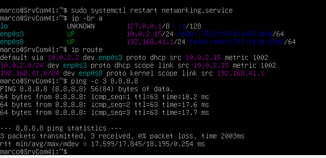

SrvCom: enp0s3 en NAT (10.0.2.15) y enp0s8 en la LAN (192.168.41.1). La ruta por defecto va por 10.0.2.2.

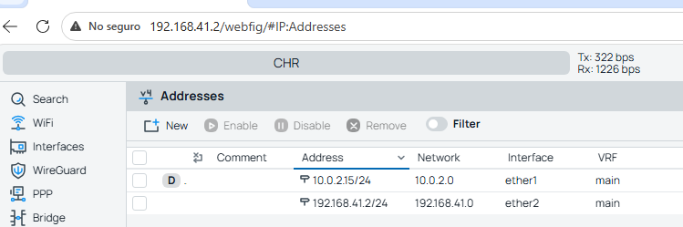

MikroTik: ether1 en NAT y ether2 con la 192.168.41.2.

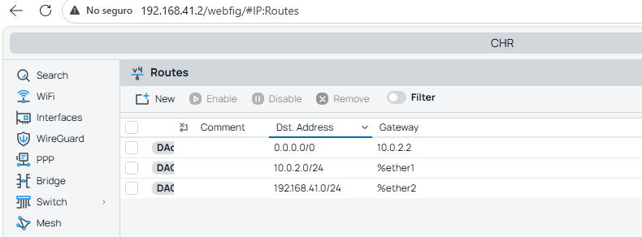

Tabla de rutas del MikroTik, la ruta por defecto va por 10.0.2.2.

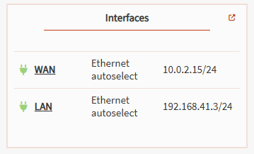

OPNsense: WAN 10.0.2.15 y LAN 192.168.41.3.

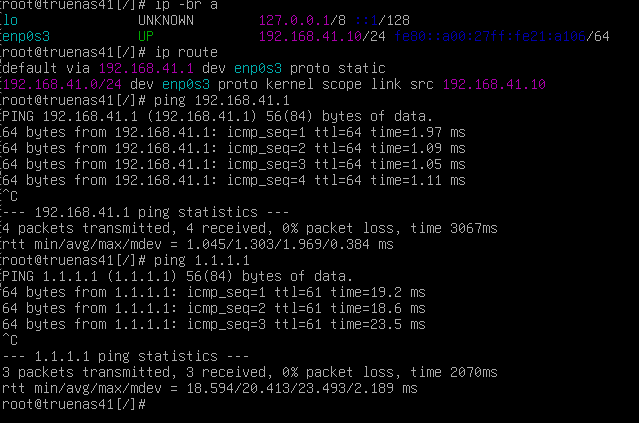

TrueNAS con la 192.168.41.10 y la ruta por defecto por SrvCom.

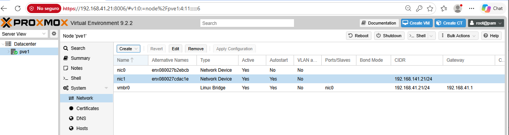

pve1 con la 192.168.41.21 en vmbr0.

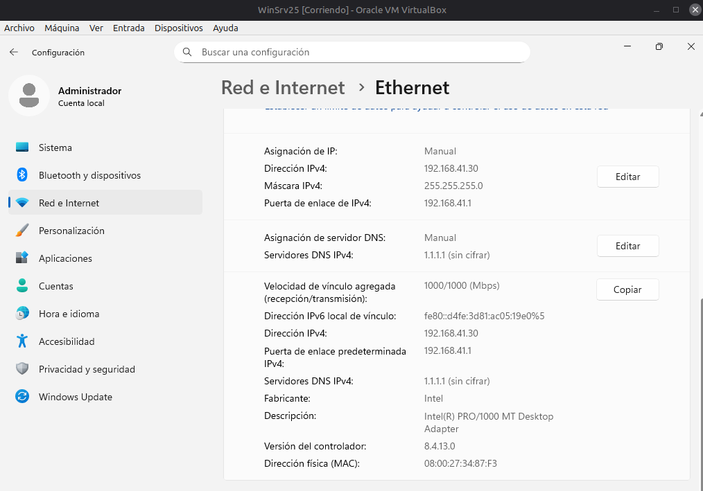

WinSrv25 con la 192.168.41.30.

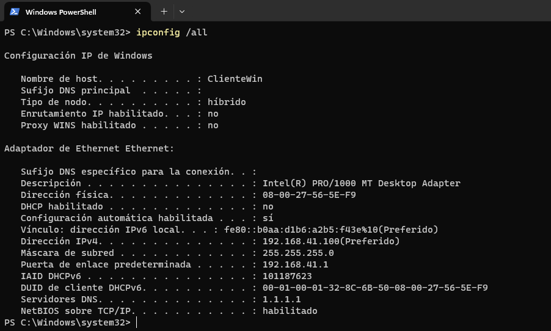

Win11Cliente con la 192.168.41.100.

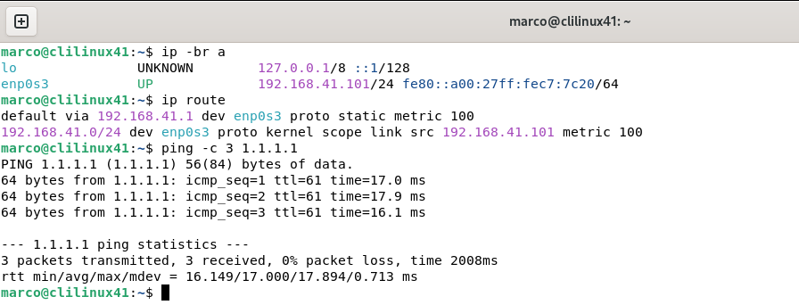

LinuxCliente con la 192.168.41.101, su tabla de rutas y ping a 1.1.1.1.

## Ping y traceroute

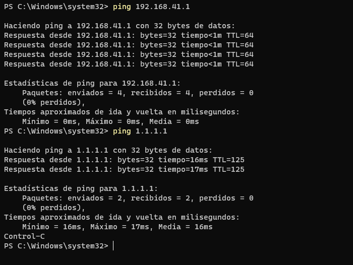

Desde Win11Cliente responde SrvCom (red interna) y 1.1.1.1 (internet).

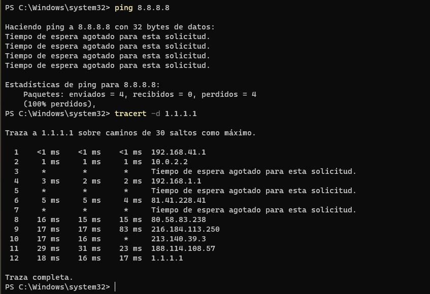

Saliendo por SrvCom: 192.168.41.1, despues 10.0.2.2 (NAT de VirtualBox), 192.168.1.1 (router de casa) e internet.

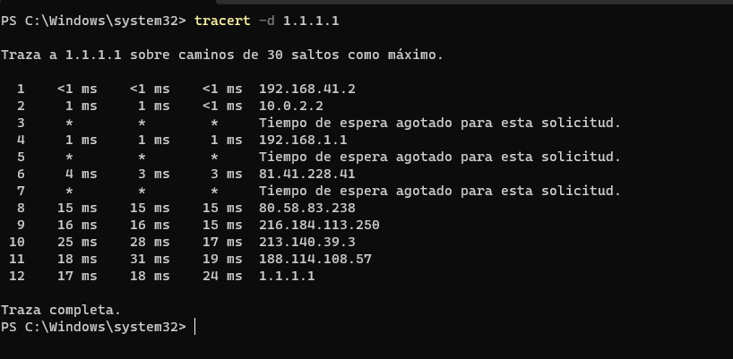

Saliendo por MikroTik el primer salto es 192.168.41.2.

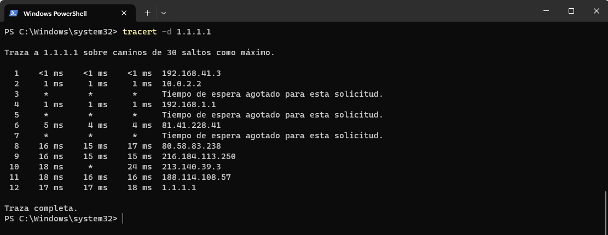

Saliendo por OPNsense el primer salto es 192.168.41.3.
