# Copias

## Donde y como

Las copias se guardan en TrueNAS (192.168.41.10), en el pool copias que tiene dos discos en espejo. Dentro del pool hay un dataset compartido por SMB con el nombre backupa (\\192.168.41.10\backupa). Se entra con el usuario marco.

Se copia solo la configuracion de cada maquina, no la maquina entera. La configuracion ocupa muy poco y con ella se puede volver a montar el servidor instalando el sistema otra vez. Las imagenes enteras ocuparian demasiado para el espacio que hay.

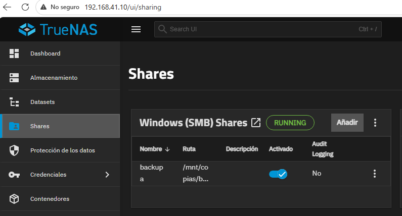

La carpeta compartida backupa esta activada y el servicio SMB funcionando.

## SrvCom

Se copia /etc/nftables.conf (firewall y NAT), /etc/network/interfaces (red) y /etc/sysctl.d/99-router.conf (reenvio de paquetes).

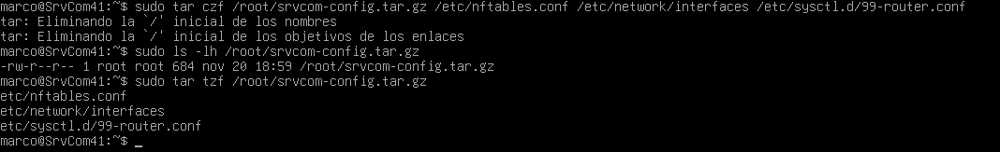

Se juntan en un tar.gz y con tar tzf se ve lo que hay dentro.

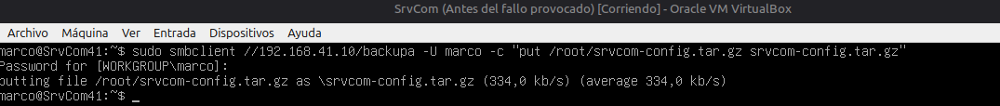

Se sube a TrueNAS con smbclient porque SrvCom no tiene entorno grafico.

## MikroTik

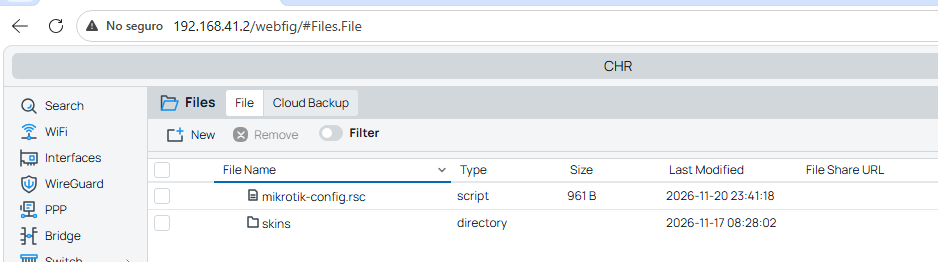

Se exporta la configuracion a mikrotik-config.rsc.

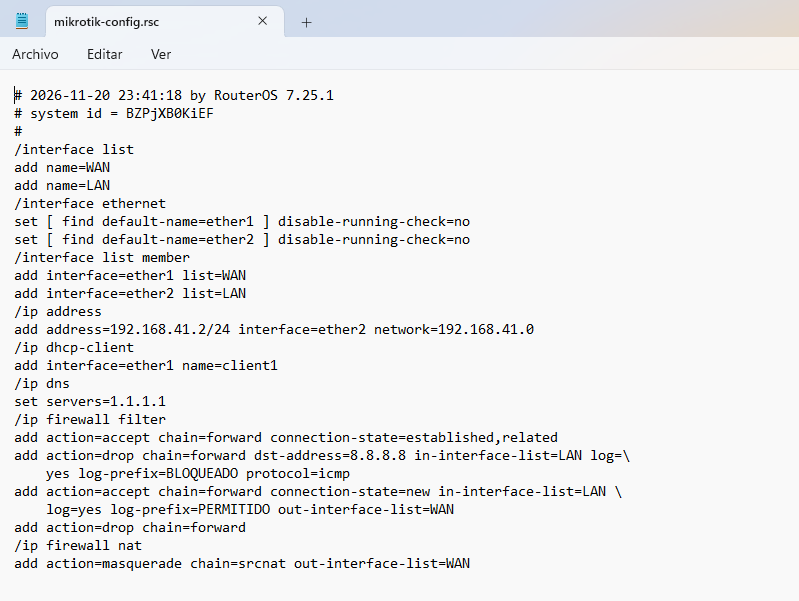

Es un fichero de texto con las interfaces, la IP, el DNS, las reglas del firewall y el NAT. Se puede leer y pegar en otro MikroTik.

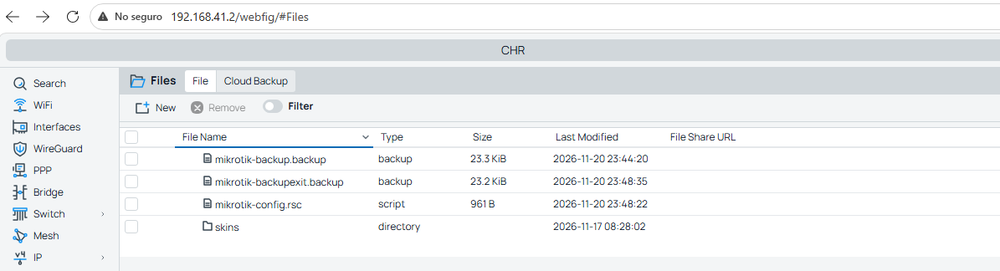

Tambien se hace un backup completo (mikrotik-backup.backup), que solo sirve para el mismo equipo pero lo restaura todo de una vez. Los dos ficheros se descargan y se suben a TrueNAS.

## OPNsense

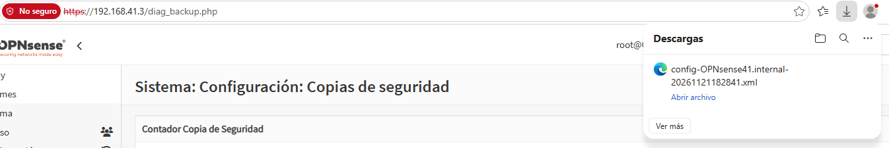

Desde Sistema > Configuracion > Copias de seguridad se descarga el xml, que tiene toda la configuracion (interfaces, alias, reglas, usuarios). Se sube a TrueNAS.

## Proxmox

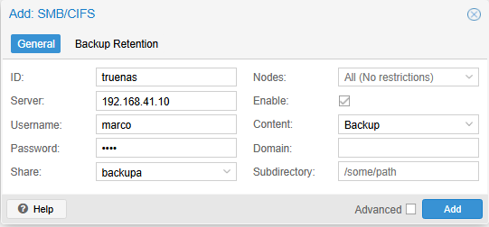

Se anade la carpeta backupa de TrueNAS como almacenamiento SMB/CIFS en Proxmox, para guardar backups. Sirve para los tres nodos.

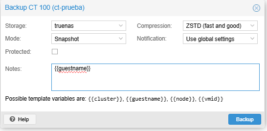

Se hace backup del CT 100 en ese almacenamiento, en modo Snapshot (sin apagarlo) y comprimido con ZSTD.

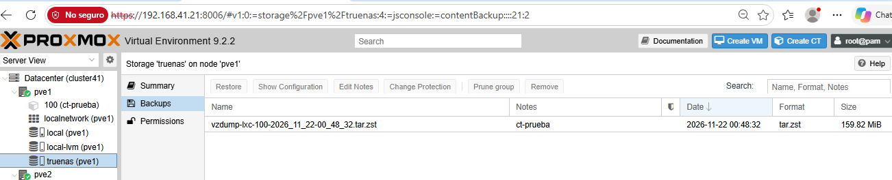

El backup queda guardado en TrueNAS y ocupa 159,82 MB, mucho menos que el disco de 4 GB porque solo guarda los datos y va comprimido.

Ademas se copia /etc/pve, /etc/network/interfaces y /etc/hosts en pve-config.tar.gz, que es la configuracion del cluster y la red de los nodos. La VM 101 no se copia porque no tiene nada dentro.

## WinSrv25

Se guarda la configuracion de red y la lista de usuarios del dominio. No se hace copia del estado del sistema entero porque ocupa varios GB y no cabe bien en el espacio de copias.

## Win11Cliente

Se guarda la configuracion de red (ipconfig /all) en un txt. No se hace imagen del sistema porque es un cliente sin datos importantes y se puede reinstalar.

## LinuxCliente

Se copia la red (/etc/NetworkManager/system-connections), /etc/hosts y los repositorios en un tar.gz. Igual que en Windows, no se hace imagen porque es un cliente.

## Todo en TrueNAS

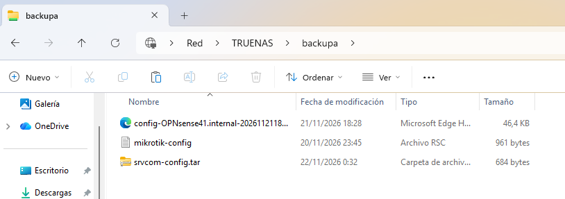

Desde Win11Cliente se ve la carpeta backupa con las copias de OPNsense (xml), MikroTik (rsc) y SrvCom (tar.gz).
