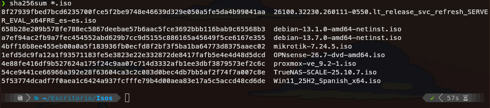

# ISOs

## Origen y arquitectura

Todas las ISO se descargan de la web oficial de cada fabricante y son de 64 bits (amd64 / x64), que es lo que soporta VirtualBox en este equipo.

| Sistema | ISO | Origen | Arquitectura |
|---|---|---|---|
| Windows Server 2025 | 26100.32230...SERVER_EVAL_x64FRE_es-es.iso | microsoft.com (Evaluation Center) | x64 |
| Debian 13 | debian-13.1.0 y 13.7.0-amd64-netinst.iso | debian.org | amd64 |
| MikroTik CHR | mikrotik-7.24.5.iso | mikrotik.com | x86 64 bits |
| OPNsense | OPNsense-26.7-dvd-amd64.iso | opnsense.org | amd64 |
| Proxmox VE | proxmox-ve_9.2-1.iso | proxmox.com | amd64 |
| TrueNAS | TrueNAS-SCALE-25.10.7.iso | truenas.com | amd64 |
| Windows 11 | Win11_25H2_Spanish_x64.iso | microsoft.com | x64 |

## Hashes

Se calcula el SHA256 de cada ISO con sha256sum y se compara con el que publica el fabricante en su web. Si coinciden, la ISO no esta corrupta ni modificada.

La ISO de evaluacion de Windows Server no trae hash publicado, asi que solo se puede fiar del origen (web de Microsoft).
