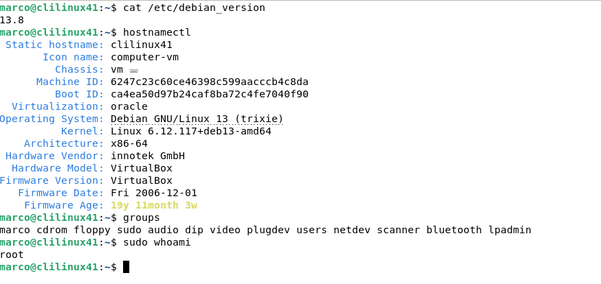
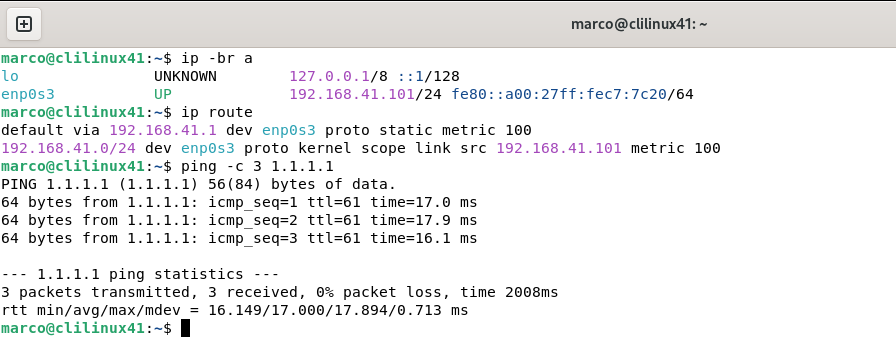

# LinuxCliente

- Sistema: Debian 13.8 (trixie) con escritorio
- Nombre: clilinux41
- IP: 192.168.41.101/24
- Puerta de enlace: 192.168.41.1
- DNS: 1.1.1.1
- Funcion: cliente Linux

## Version y usuario

Debian 13.8 con kernel 6.12 de 64 bits. El usuario marco esta en el grupo sudo y con sudo whoami sale root, asi que es el usuario de administracion.

## Red

enp0s3 tiene la 192.168.41.101 fija y la ruta por defecto va por SrvCom (192.168.41.1). Llega a 1.1.1.1, asi que tiene internet.

## Copia

Se copia la configuracion de red y los repositorios en un tar.gz y se sube a la carpeta de TrueNAS. No se hace imagen entera porque es un cliente sin datos importantes y se puede reinstalar.

## Dominio

No se une al dominio porque en el diseno no se decidio hacerlo.
