# MikroTik

- Sistema: MikroTik CHR (RouterOS 7.25.1)
- ether1: NAT (10.0.2.15 por DHCP)
- ether2: intnet41, 192.168.41.2/24
- DNS: 1.1.1.1
- Funcion: router de la red, alternativa a SrvCom

Todo se configuro desde la web (WebFig).

## Version

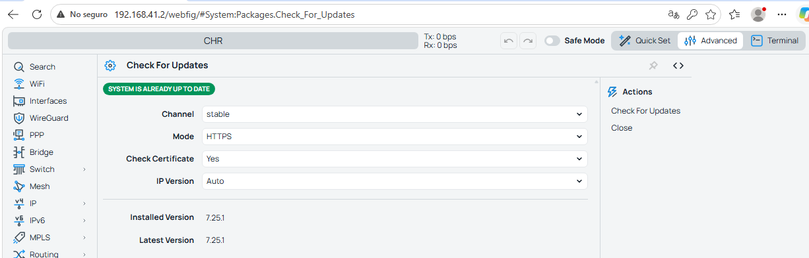

Se instalo la 7.24.5 y se actualizo a la 7.25.1. Sale que el sistema esta al dia.

## Usuario

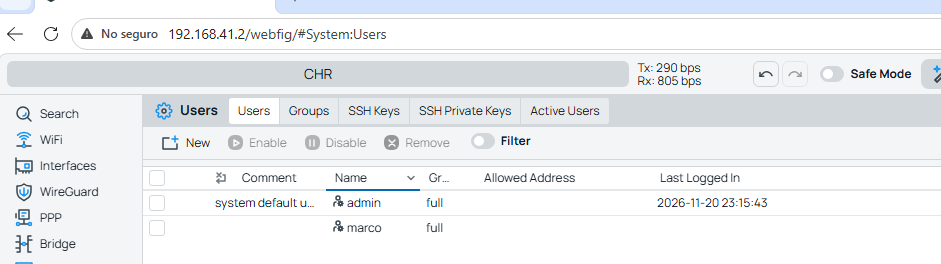

Ademas de admin se creo el usuario marco con grupo full para administrar.

## Red

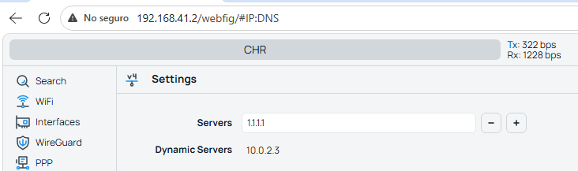

DNS 1.1.1.1.

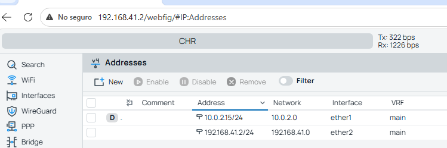

ether1 coge la 10.0.2.15 por DHCP (sale con la D de dinamica) y ether2 tiene la 192.168.41.2 fija.

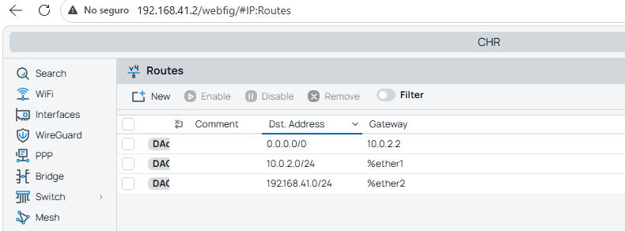

La ruta por defecto va por 10.0.2.2, que es el NAT de VirtualBox.

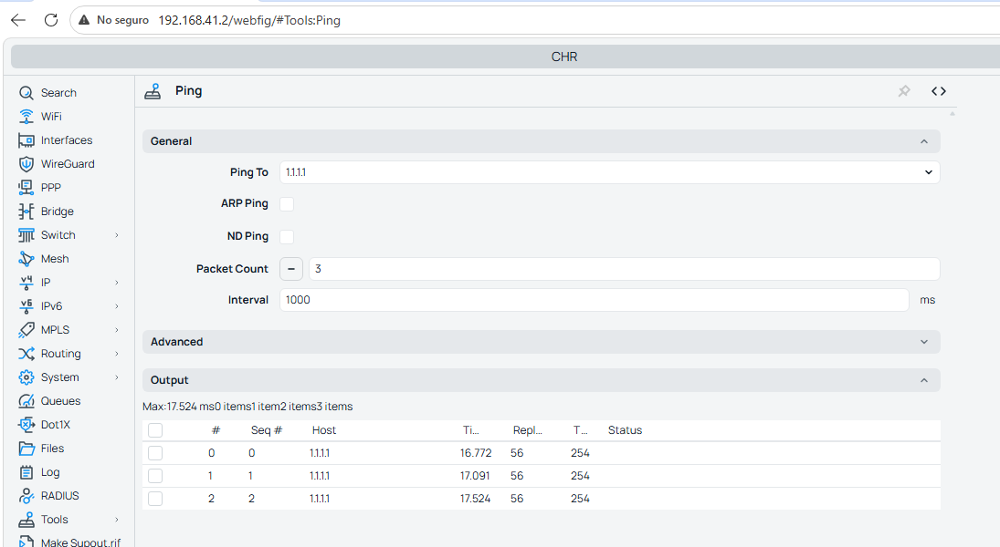

El MikroTik llega a 1.1.1.1.

## Firewall

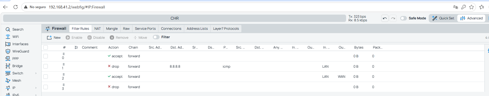

Reglas en forward por orden:
1. Se acepta lo que ya esta establecido.
2. Se bloquea el ping de la LAN a 8.8.8.8.
3. Se acepta lo nuevo que va de LAN a WAN.
4. Se tira todo lo demas.

## Pruebas desde Win11Cliente

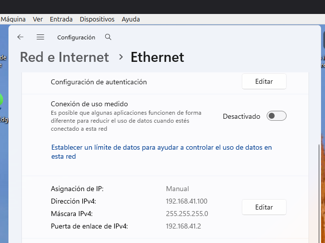

Para probar se cambia la puerta de enlace de Win11Cliente a 192.168.41.2.

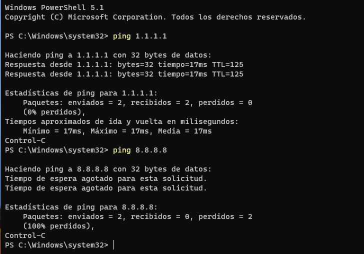

1.1.1.1 responde y 8.8.8.8 no, porque esta bloqueado.

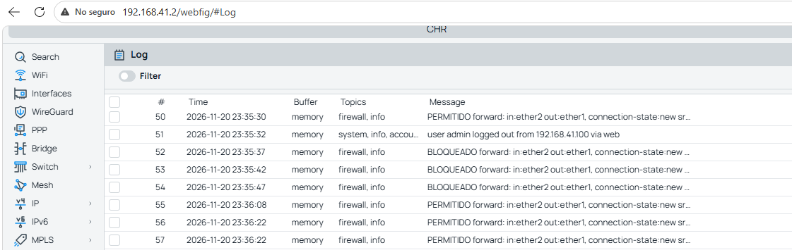

En el log salen las conexiones de ether2 a ether1 como PERMITIDO y los ping a 8.8.8.8 como BLOQUEADO.

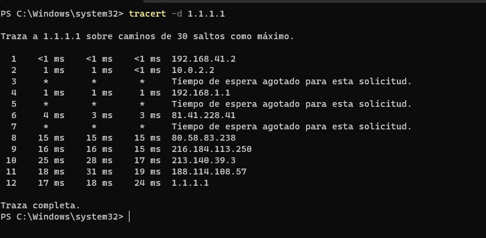

El primer salto ahora es el MikroTik (192.168.41.2) en vez de SrvCom.

## Copia

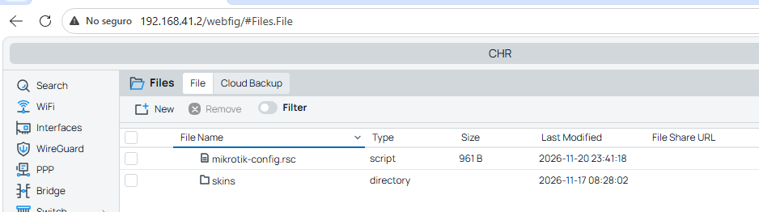

Se exporta la configuracion a mikrotik-config.rsc.

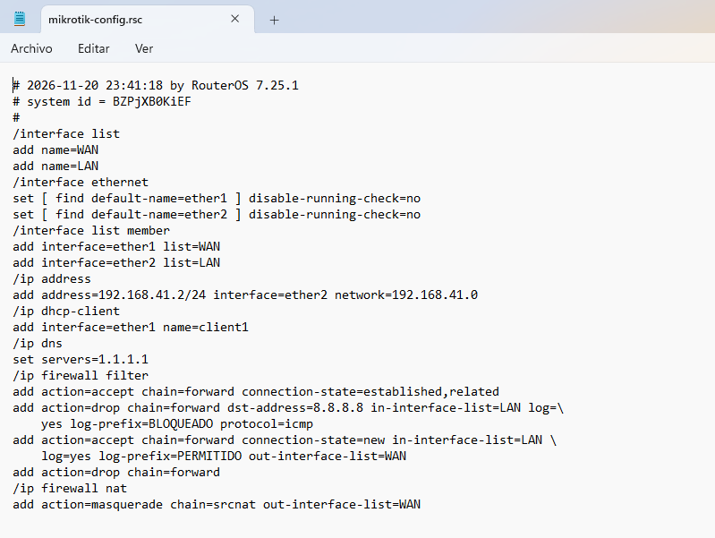

El rsc tiene en texto las listas WAN y LAN, la IP, el DHCP de ether1, el DNS, las reglas del firewall y el NAT.

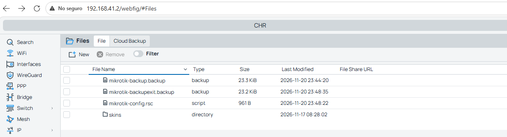

Tambien se hace un backup completo (mikrotik-backup.backup). Los dos ficheros se descargan y se guardan en TrueNAS.

## Prueba de fallo y restauracion

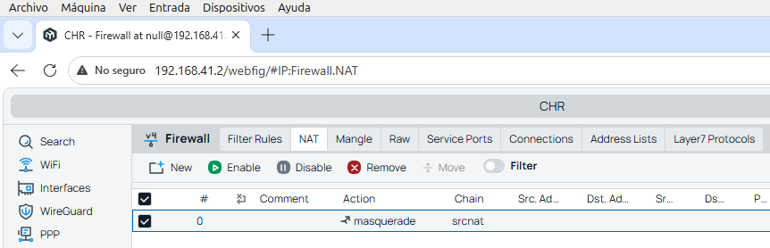

Se borra la regla de NAT a proposito.

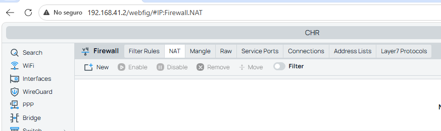

Ya no hay ninguna regla de NAT.

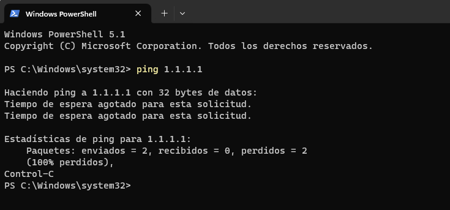

Win11Cliente ya no llega a 1.1.1.1.

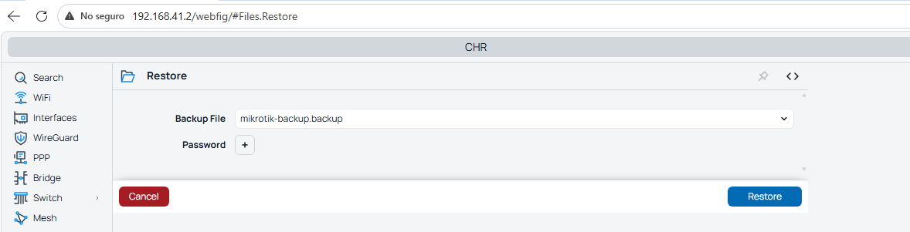

Se restaura mikrotik-backup.backup desde Files.

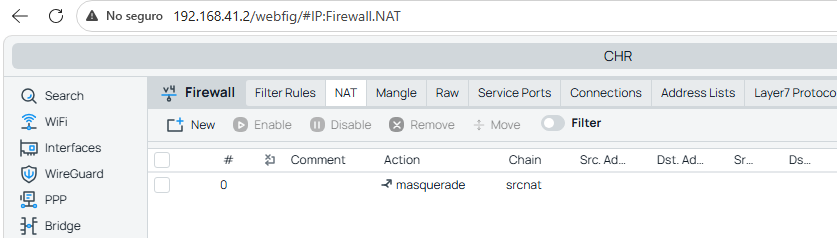

Despues de reiniciar vuelve a estar la regla masquerade y el cliente vuelve a tener internet.
