# OPNsense

- Sistema: OPNsense 26.7 (amd64)
- WAN (le0): NAT, 10.0.2.15 por DHCP
- LAN (le1): intnet41, 192.168.41.3/24
- Funcion: firewall de la red, alternativa a SrvCom y MikroTik

## Version

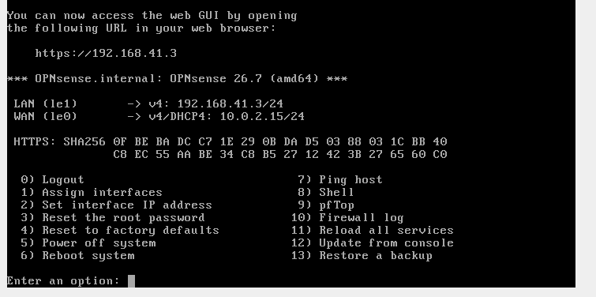

En la consola sale la version 26.7 y las dos interfaces con sus IPs. La web se abre en https://192.168.41.3.

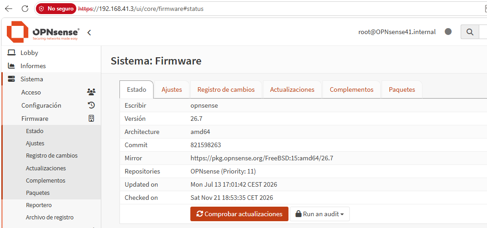

En Sistema > Firmware se ve la version 26.7 y que se comprobaron las actualizaciones.

## Usuario

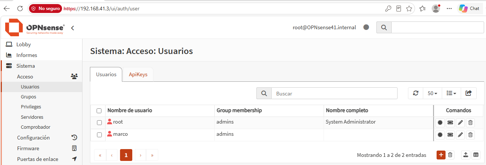

Ademas de root se creo el usuario marco dentro del grupo admins para administrar.

## Red

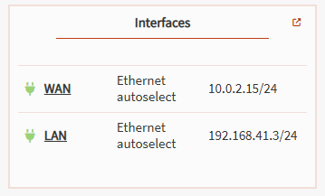

WAN con la 10.0.2.15 y LAN con la 192.168.41.3.

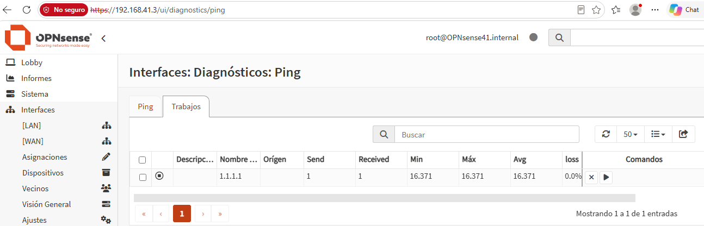

Desde Diagnosticos el OPNsense llega a 1.1.1.1 sin perder paquetes.

## NAT y reglas

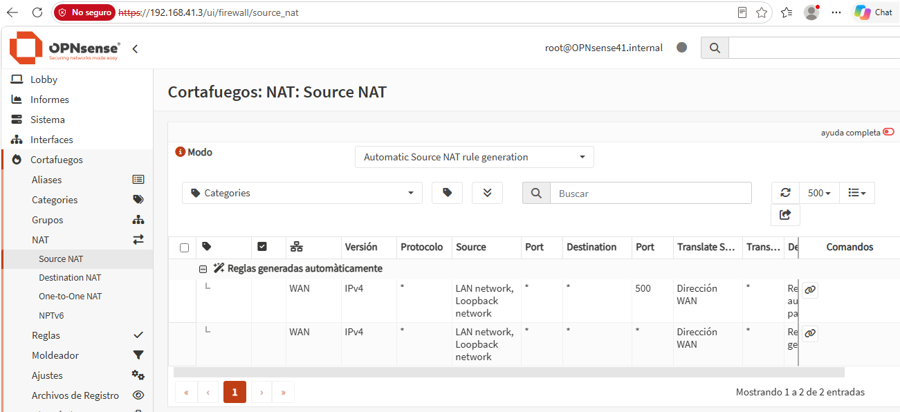

El NAT de salida esta en automatico. Saca la red LAN por la direccion de la WAN.

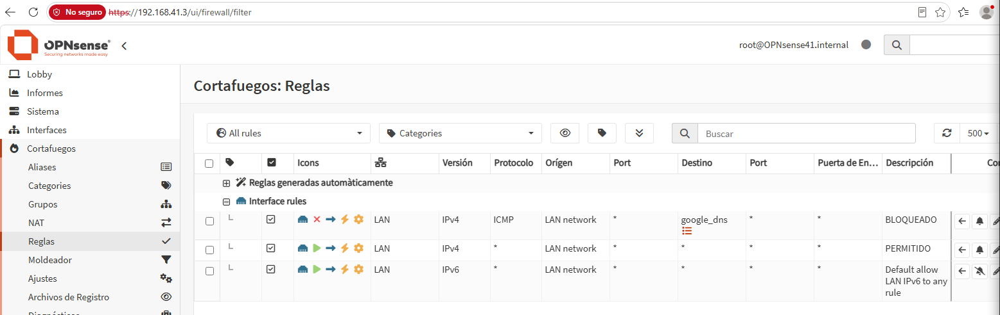

En la LAN la regla BLOQUEADO va primero y tira el ICMP hacia el alias google_dns (8.8.8.8). Debajo esta PERMITIDO, que deja salir el resto de la LAN.

## Pruebas desde Win11Cliente

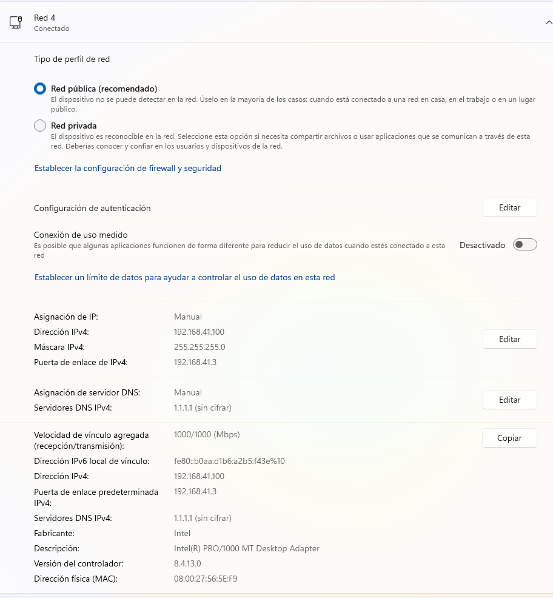

Se cambia la puerta de enlace de Win11Cliente a 192.168.41.3.

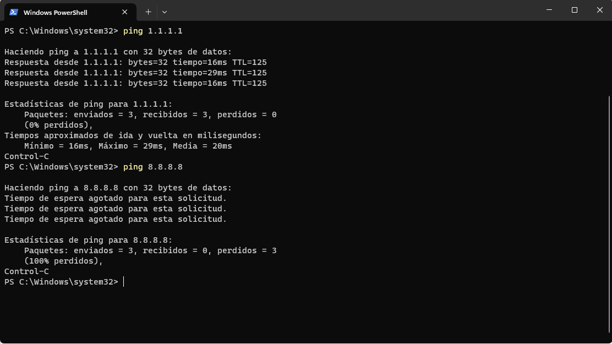

1.1.1.1 responde y 8.8.8.8 no.

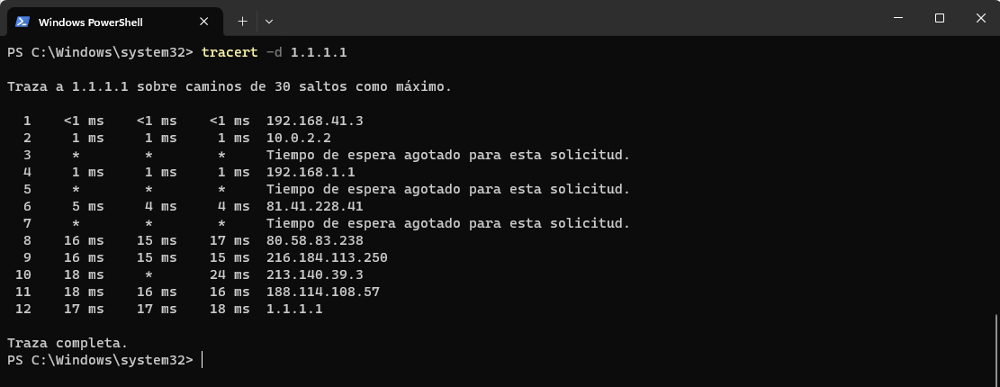

El primer salto ahora es el OPNsense (192.168.41.3).

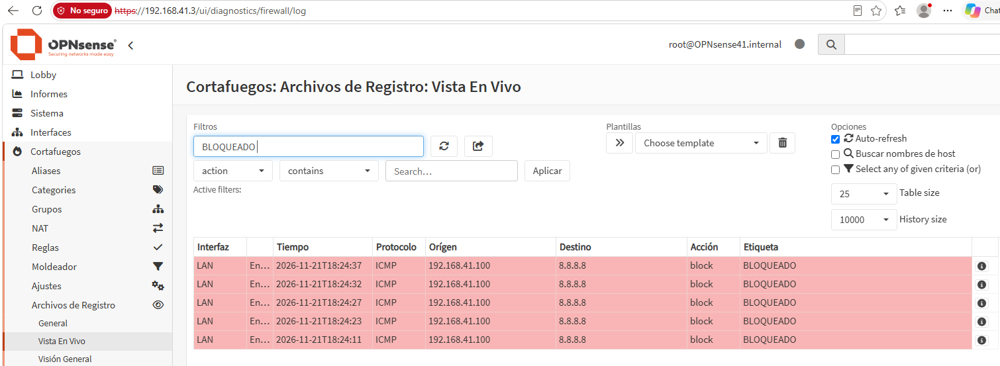

En el log en vivo salen en rojo los ping de 192.168.41.100 a 8.8.8.8 con accion block y etiqueta BLOQUEADO.

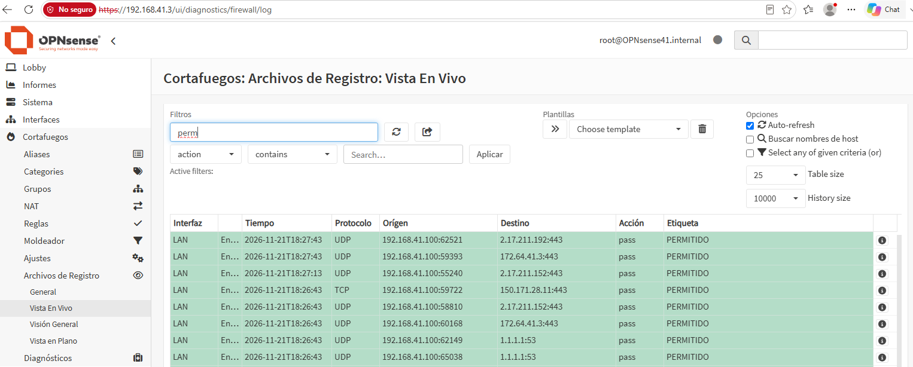

Y en verde las conexiones del cliente a internet (puerto 443 y DNS al 53) con accion pass y etiqueta PERMITIDO.

## Copia

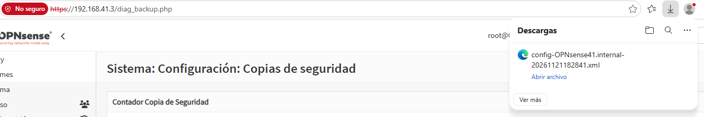

Desde Sistema > Configuracion > Copias de seguridad se descarga el xml con toda la configuracion y se guarda en TrueNAS.

## Prueba de fallo y restauracion

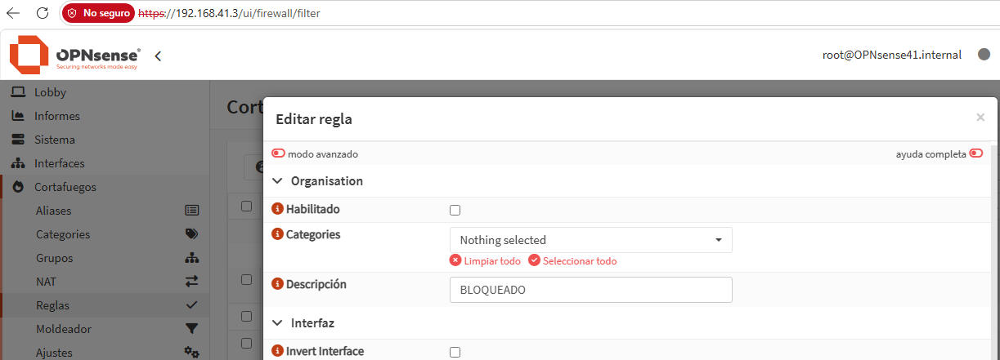

Se deshabilita la regla BLOQUEADO a proposito.

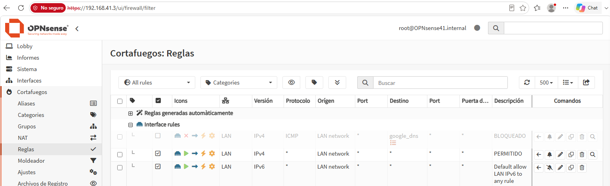

La regla sale en gris.

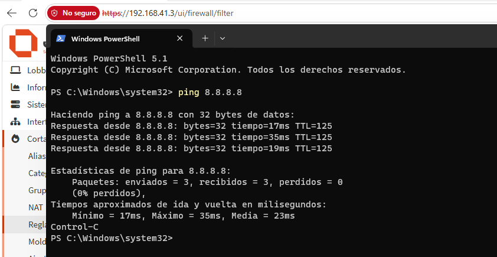

Ahora el ping a 8.8.8.8 responde, el bloqueo ya no funciona.

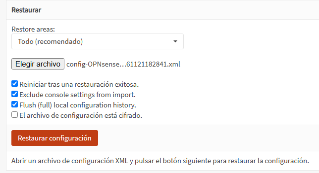

Se restaura el xml descargado antes.

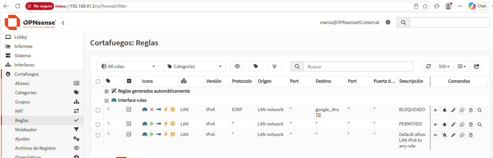

Despues de reiniciar la regla BLOQUEADO vuelve a estar activa.

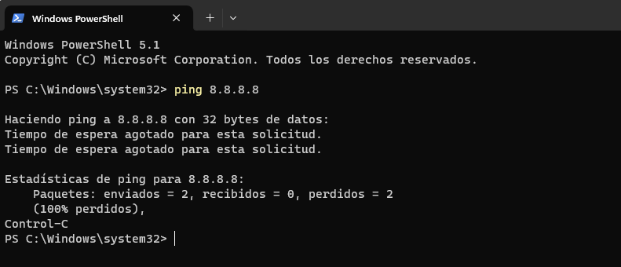

Y el ping a 8.8.8.8 vuelve a estar bloqueado.
