# Proxmox

- Sistema: Proxmox VE 9.2.2
- Nodos: pve1 (192.168.41.21), pve2 (192.168.41.22) y pve3 (192.168.41.23)
- Puerta de enlace: 192.168.41.1
- DNS: 1.1.1.1
- Funcion: virtualizacion en cluster

## Instalacion

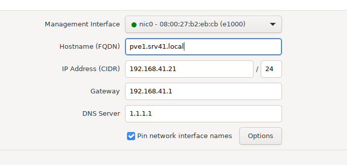

En la instalacion se pone el nombre pve1.srv41.local, la IP fija, la puerta de enlace SrvCom y el DNS. Los otros dos nodos igual con su IP.

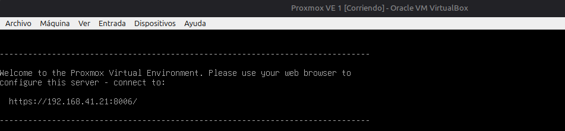

Al arrancar indica la direccion de la web: https://192.168.41.21:8006.

## Usuario

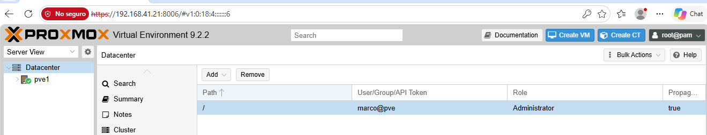

Ademas de root se crea el usuario marco@pve con el rol Administrator en / para administrar todo.

## Red

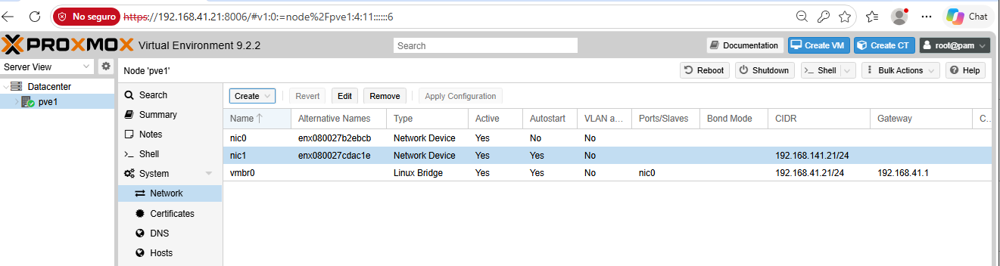

vmbr0 es el puente con la 192.168.41.21 y la puerta de enlace, y por ahi salen las maquinas que se crean. nic1 esta en la red interna proxmox con la 192.168.141.21.

## Cluster

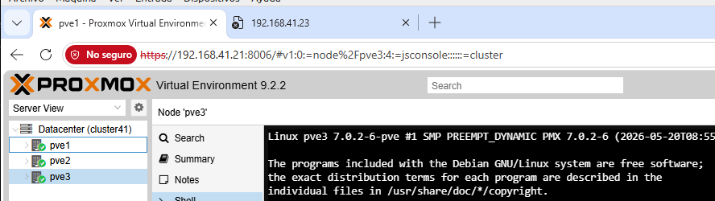

Se crea el cluster cluster41 en pve1 y se unen pve2 y pve3. Los tres salen en verde. Al final el cluster va por la red 192.168.41.0/24 porque pve3 se unio con la IP de esa red.

## Contenedor (CT 100)

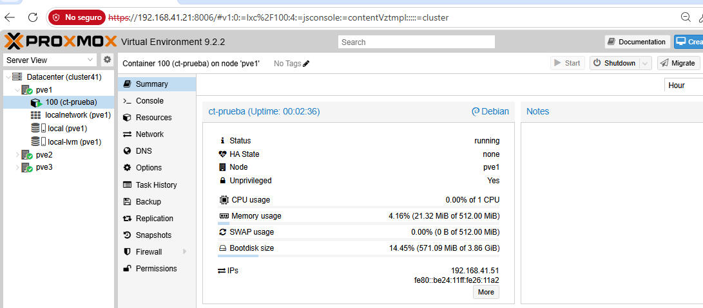

CT 100 ct-prueba con la plantilla debian-13-standard, 512 MB de RAM, disco de 4 GB y la IP 192.168.41.51. Solo ocupa 571 MB del disco.

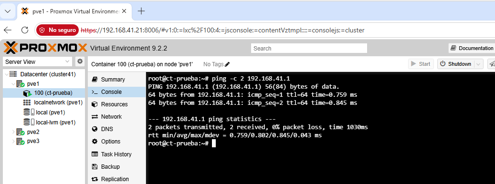

Desde el contenedor llega a SrvCom.

## Maquina virtual (VM 101)

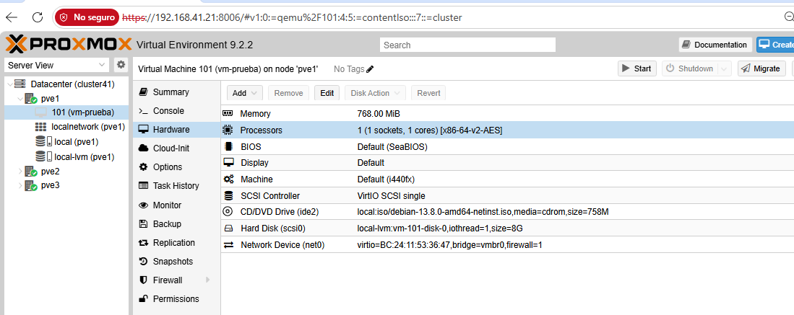

VM 101 vm-prueba con 768 MB de RAM, 1 nucleo y disco de 8 GB.

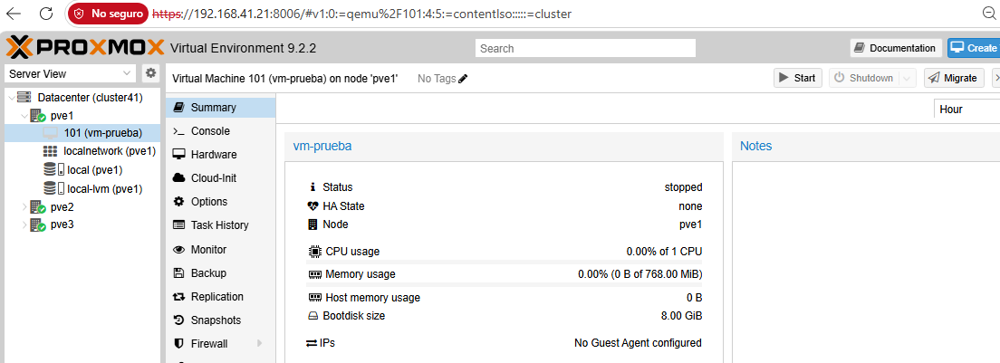

La VM esta parada en pve1. No se pudo instalar Debian porque al arrancarla VirtualBox se colgaba por falta de RAM.

## Migracion del CT

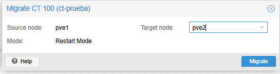

Se migra de pve1 a pve2 en modo Restart: el contenedor se apaga, se copia y se enciende en el otro nodo.

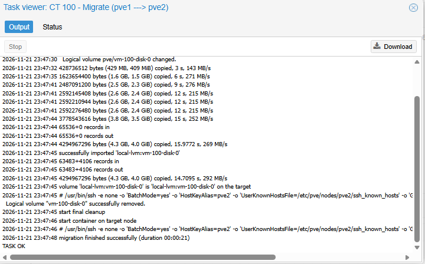

Se copian 4,3 GB en unos 16 s y la migracion entera tarda 21 s.

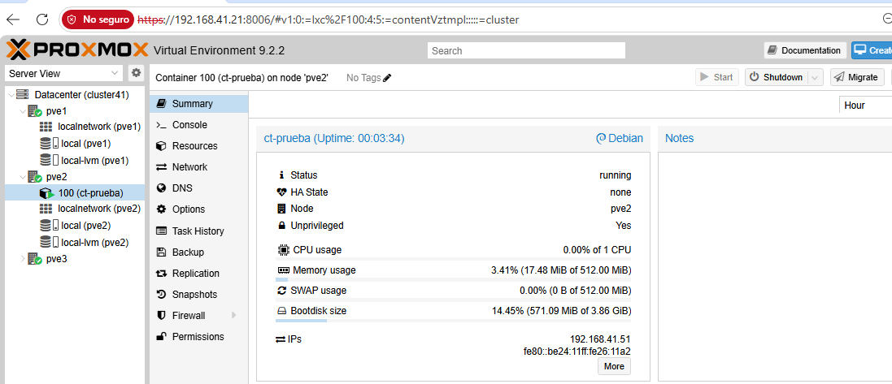

El CT ya esta en pve2, encendido y con la misma IP.

## Migracion de la VM

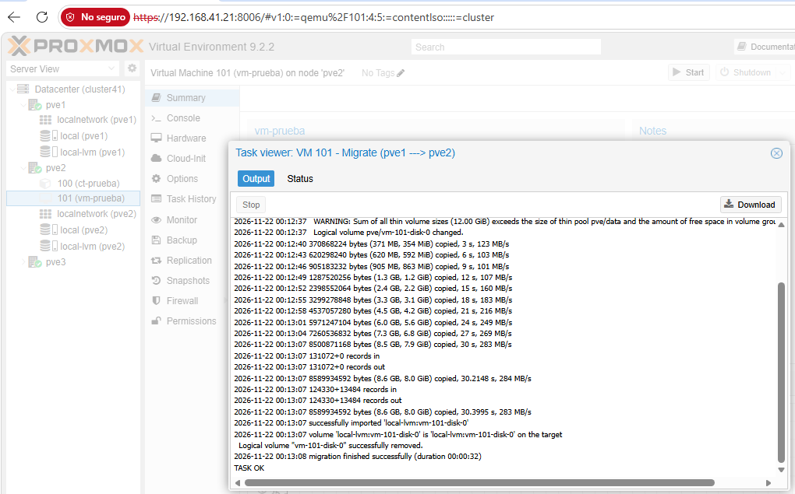

Se copian 8,6 GB en unos 30 s y la migracion entera tarda 32 s.

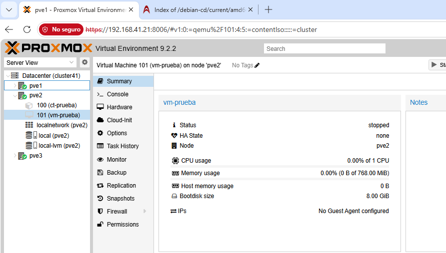

La VM ya esta en pve2.

## Comparacion

| | CT 100 | VM 101 |
|---|---|---|
| Disco | 4 GB | 8 GB |
| Copiado | 4,3 GB | 8,6 GB |
| Tiempo | 21 s | 32 s |

El CT tarda menos porque su disco es mas pequeno. En los dos casos se copia el disco entero aunque casi no tenga datos (el CT solo usa 571 MB), asi que el tiempo depende del tamano del disco y no de lo que hay dentro.

Mejoras:
- Usar almacenamiento compartido (por ejemplo NFS en TrueNAS o Ceph). Asi el disco no se copia y la migracion tarda segundos.
- Hacer los discos mas pequenos si no hace falta tanto espacio.
- Usar replicacion con ZFS para que el otro nodo ya tenga casi todo copiado.

## Virtualizar

Ventajas:
- Varias maquinas en un solo equipo fisico.
- Las maquinas se pueden mover de un nodo a otro.
- Copias y snapshots faciles.

Inconvenientes:
- Gasta mucha RAM y CPU del equipo fisico.
- Si falla el equipo fisico fallan todas las maquinas que tiene.
- Virtualizar dentro de VirtualBox va lento y da errores.

## Contenedor o maquina virtual

| | Contenedor | Maquina virtual |
|---|---|---|
| Kernel | Usa el del nodo | Tiene el suyo |
| Recursos | Pocos | Mas |
| Arranque | Segundos | Mas lento |
| Sistemas | Solo Linux | Cualquiera |
| Aislamiento | Menor | Mayor |
