# SrvCom

- Sistema: Debian 13
- enp0s3: NAT (10.0.2.15 por DHCP)
- enp0s8: intnet41, 192.168.41.1/24
- Funcion: router de la red. Hace NAT para que las maquinas salgan a internet y filtra con nftables.

## Usuario

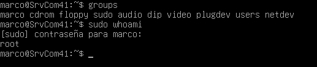

El usuario marco esta en el grupo sudo y con sudo whoami sale root, asi que puede administrar sin entrar como root.

## Red

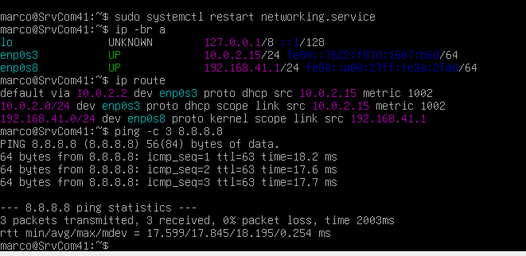

enp0s3 coge la IP 10.0.2.15 por DHCP de VirtualBox y enp0s8 tiene la 192.168.41.1 fija. La ruta por defecto va por 10.0.2.2. El ping a 8.8.8.8 desde el propio SrvCom funciona porque el bloqueo solo afecta al trafico que viene de la LAN.

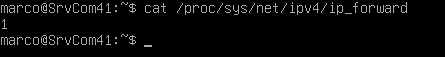

ip_forward esta a 1, asi que SrvCom pasa paquetes de una red a otra.

## Firewall

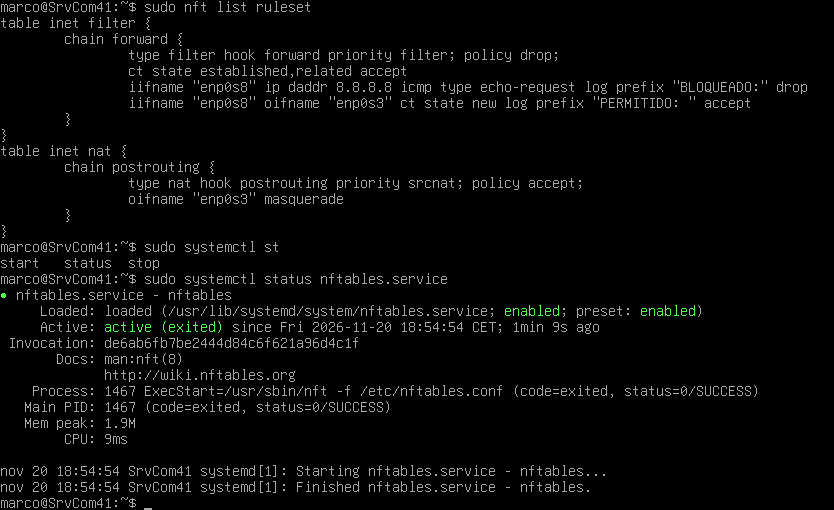

En la tabla filter la politica de forward es drop, se deja pasar lo que ya esta establecido, se bloquea el ping de la LAN a 8.8.8.8 y se permite lo demas que sale de enp0s8 a enp0s3. En la tabla nat se hace masquerade por enp0s3. El servicio nftables esta enabled para que cargue las reglas al arrancar.

## Pruebas desde Win11Cliente

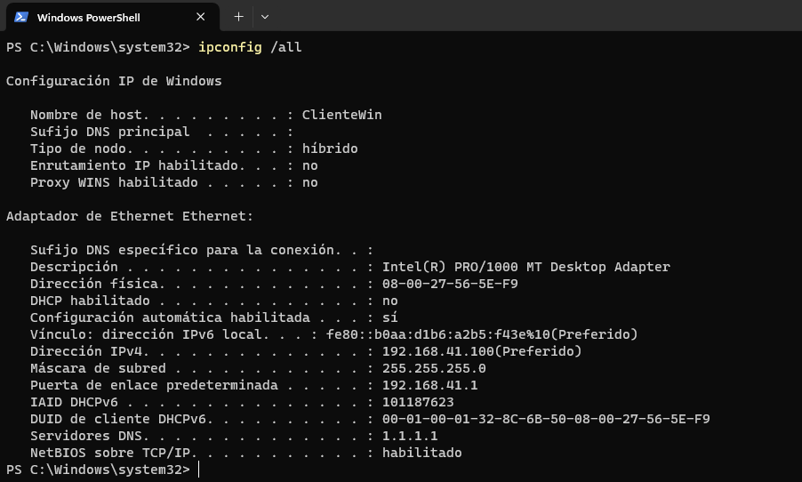

Win11Cliente tiene la 192.168.41.100 y como puerta de enlace SrvCom (192.168.41.1).

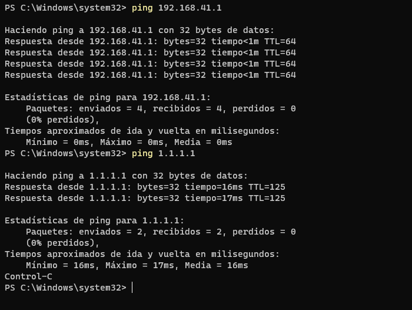

El cliente llega a SrvCom y a 1.1.1.1, asi que el NAT funciona y tiene internet.

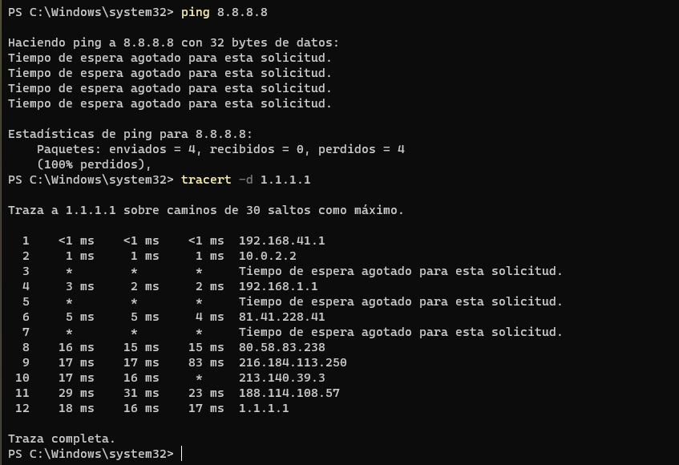

El ping a 8.8.8.8 no responde porque lo bloquea nftables. En el tracert el primer salto es SrvCom (192.168.41.1) y el segundo el NAT de VirtualBox (10.0.2.2).

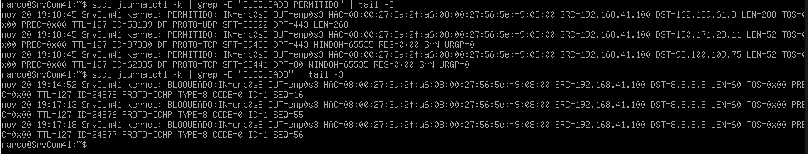

Arriba salen conexiones de Win11Cliente (192.168.41.100) a internet por los puertos 443 y 80 marcadas como PERMITIDO. Abajo salen los ping de Win11Cliente a 8.8.8.8 marcados como BLOQUEADO.

## Prueba de fallo y restauracion

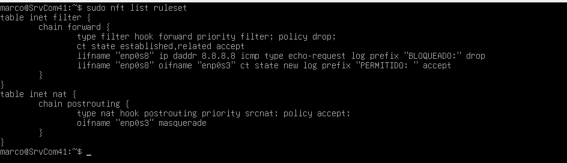

Reglas cargadas antes del fallo.

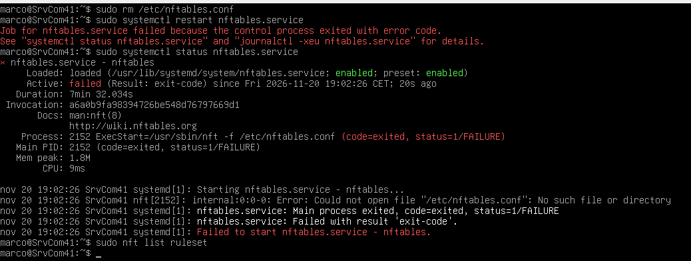

Se borra /etc/nftables.conf a proposito. Al reiniciar el servicio falla porque no encuentra el fichero y ya no hay reglas.

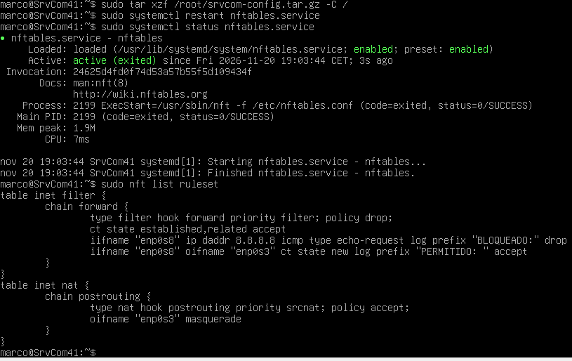

Se restaura la copia con tar xzf, se reinicia nftables y vuelven a estar todas las reglas.
