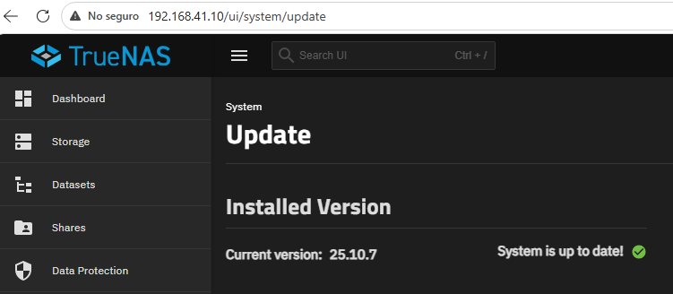
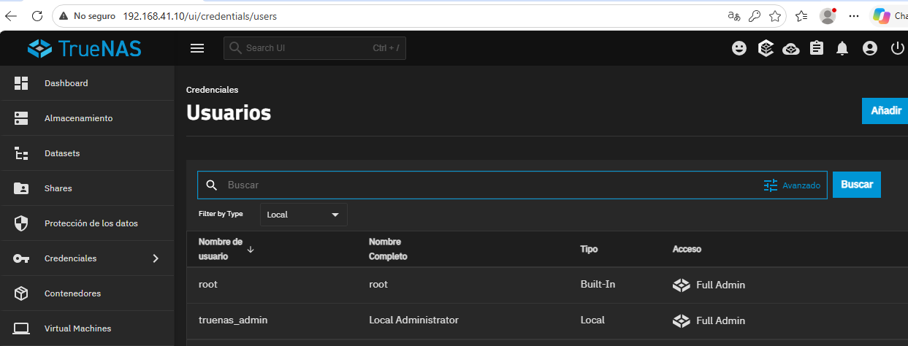
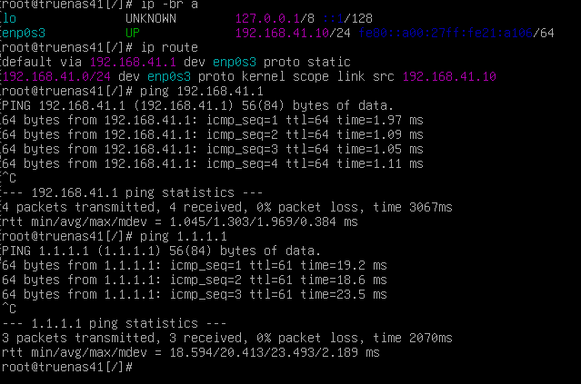
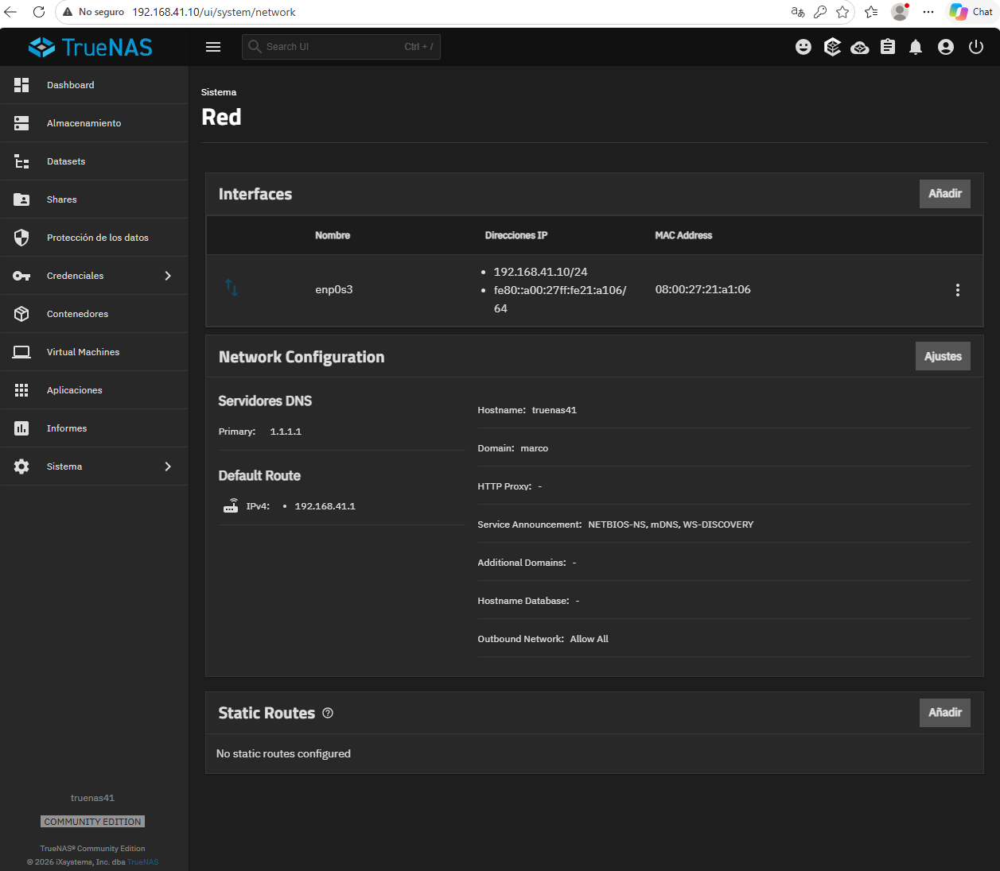
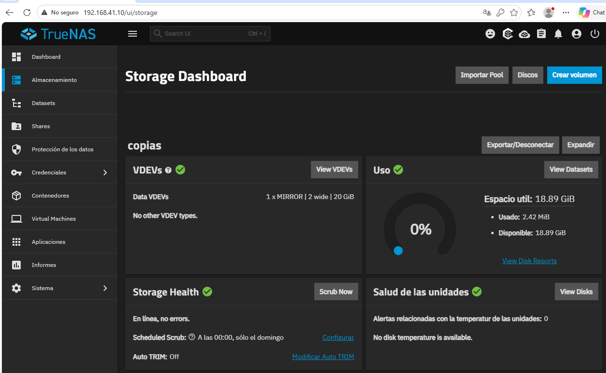
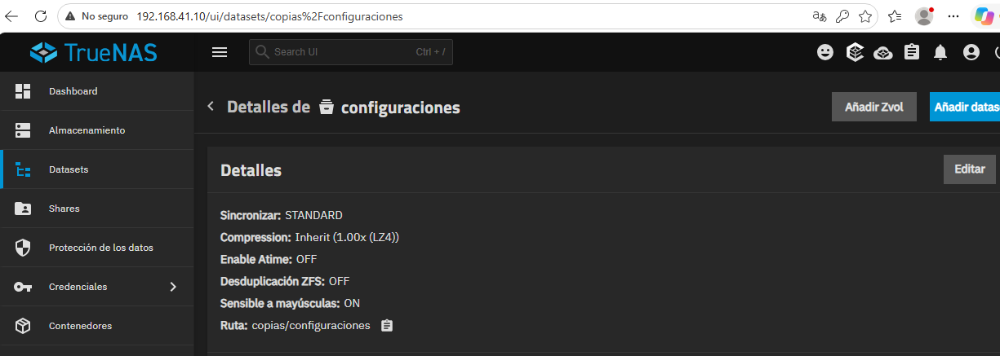

# TrueNAS

- Sistema: TrueNAS Community Edition 25.10.7
- Nombre: truenas41
- IP: 192.168.41.10/24
- Puerta de enlace: 192.168.41.1
- DNS: 1.1.1.1
- Funcion: servidor de copias

## Version

Version 25.10.7 y sale que el sistema esta actualizado.

## Usuario

truenas_admin es el usuario de administracion con Full Admin. Se usa este en vez de root para entrar a la web.

## Red

enp0s3 tiene la 192.168.41.10/24 y la ruta por defecto va por SrvCom (192.168.41.1). Responde SrvCom y 1.1.1.1, asi que tiene salida a internet.

Lo mismo desde la web: IP fija, DNS 1.1.1.1 y puerta de enlace 192.168.41.1.

## Disco para las copias

Se crea el pool copias con dos discos de 20 GB en espejo (mirror). Si falla un disco las copias siguen en el otro. Quedan 18,89 GB utiles.

Dentro del pool esta el dataset configuraciones, que es donde se guardan las copias de configuracion de las demas maquinas.
