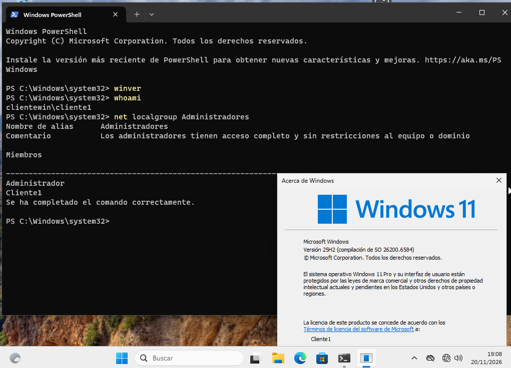
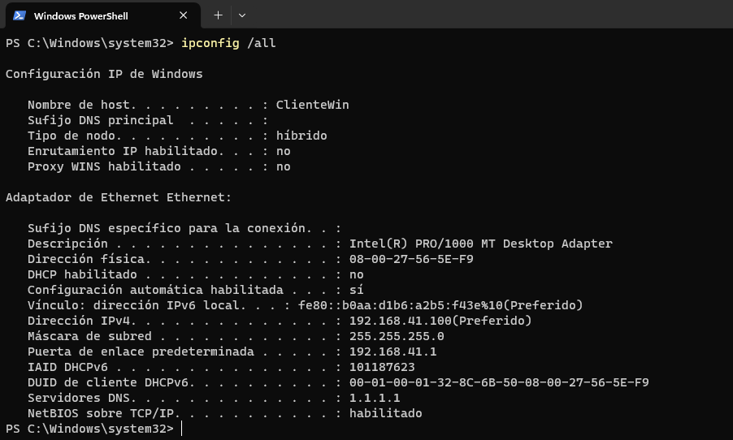
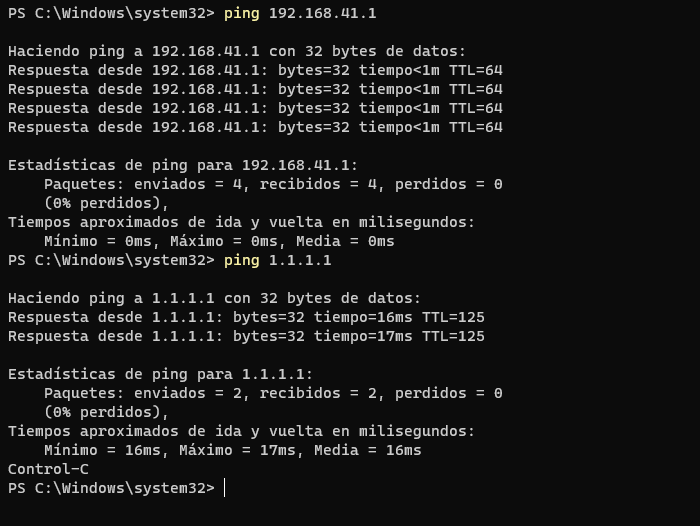
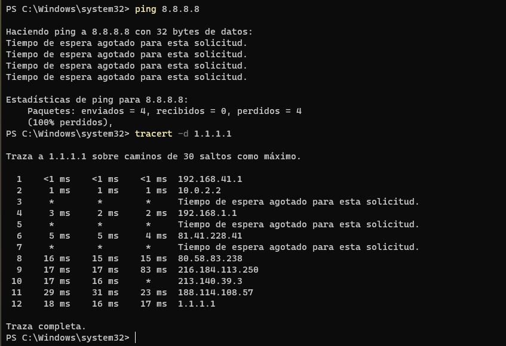
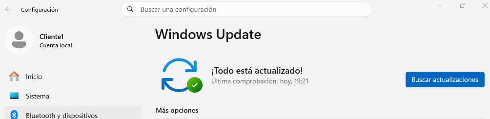

# Win11Cliente

- Sistema: Windows 11 Pro 25H2
- Nombre: ClienteWin
- IP: 192.168.41.100/24
- Puerta de enlace: 192.168.41.1
- DNS: 1.1.1.1
- Funcion: cliente Windows

## Version y usuario

Windows 11 Pro 25H2 (compilacion 26200.6584). El usuario Cliente1 esta en el grupo Administradores, asi que es el usuario de administracion del equipo.

## Red

La IP esta puesta a mano (DHCP no habilitado) con la 192.168.41.100, mascara 255.255.255.0, puerta de enlace SrvCom (192.168.41.1) y DNS 1.1.1.1.

## Pruebas de red

Responde SrvCom y tambien 1.1.1.1, asi que hay salida a internet.

El ping a 8.8.8.8 no responde porque esta bloqueado en el firewall. En el tracert a 1.1.1.1 se ve el camino: primero SrvCom (192.168.41.1), luego el NAT de VirtualBox (10.0.2.2), luego el router de casa (192.168.1.1) y despues internet.

## Actualizado

## Dominio

No se une al dominio porque en el diseño no se decidio hacerlo.
