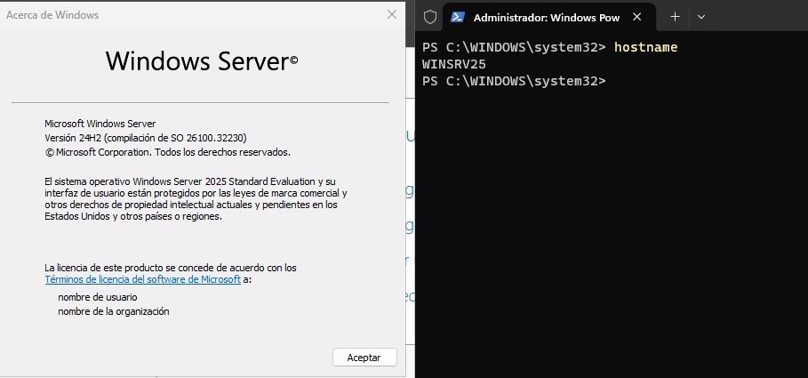
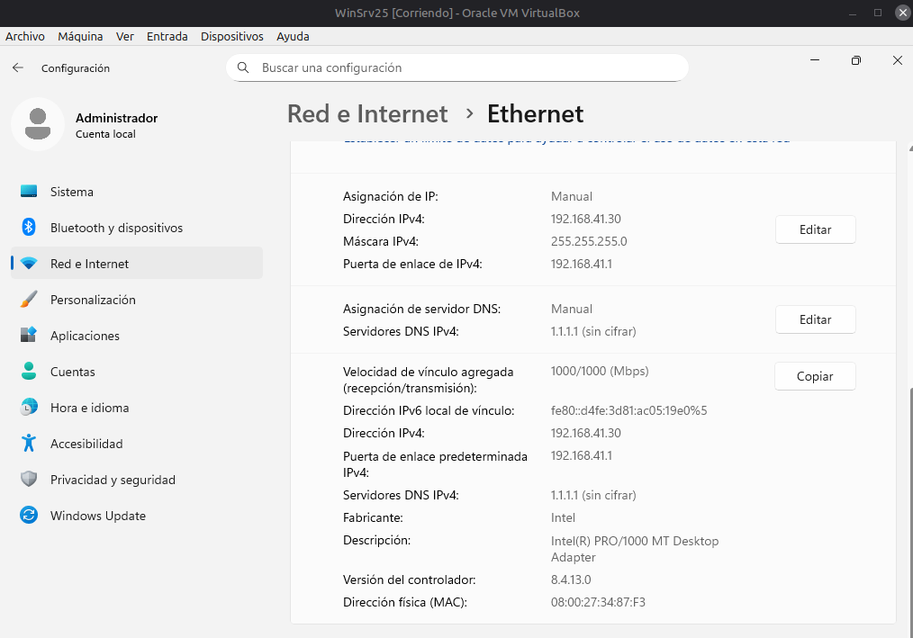
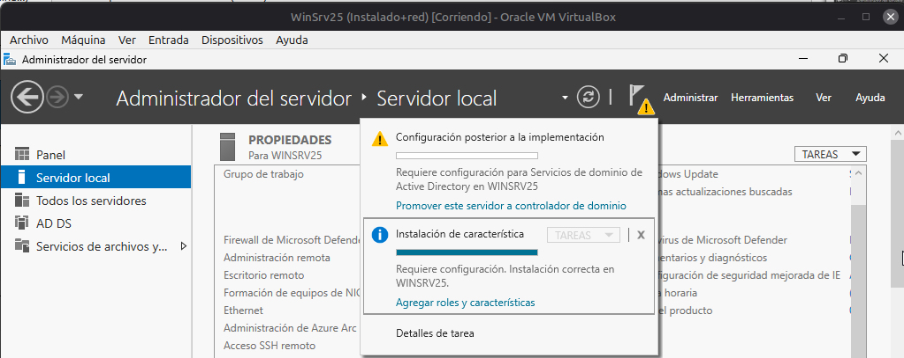
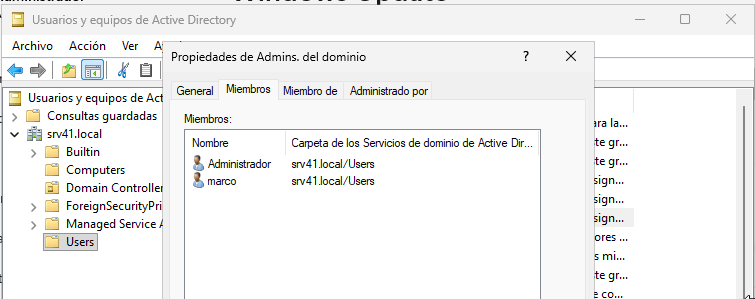
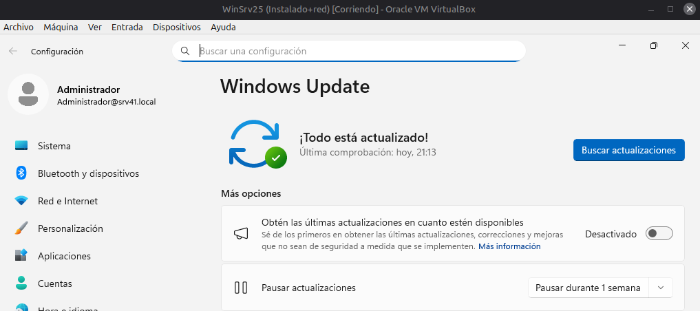

# WinSrv25

- Sistema: Windows Server 2025 Standard Evaluation (24H2)
- Nombre: WINSRV25
- IP: 192.168.41.30/24
- Puerta de enlace: 192.168.41.1
- DNS: 1.1.1.1
- Funcion: controlador de dominio srv41.local

## Version

Windows Server 2025 version 24H2 (compilacion 26100.32230). El equipo se llama WINSRV25.

## Red

IP puesta a mano con la 192.168.41.30, mascara 255.255.255.0, puerta de enlace SrvCom y DNS 1.1.1.1.

## Dominio

Se instala el rol de Servicios de dominio de Active Directory y despues se promueve el servidor a controlador de dominio creando el dominio srv41.local.

## Usuario

Se crea el usuario marco y se mete en Admins. del dominio junto al Administrador, asi puede administrar todo el dominio.

## Actualizado

Ya se entra como Administrador@srv41.local y el sistema esta actualizado.

## Que es un dominio

Un dominio es un grupo de equipos y usuarios que se gestionan desde un servidor central, el controlador de dominio. Los usuarios, contraseñas y permisos estan guardados en el servidor (en Active Directory) y no en cada equipo.

## Para que sirve

En una empresa la gestion centralizada aporta:
- Cada trabajador entra con el mismo usuario en cualquier equipo del dominio.
- Los usuarios se crean, se cambian o se bloquean desde un solo sitio. Si alguien se va de la empresa se desactiva su cuenta y ya no puede entrar en ningun equipo.
- Con las directivas de grupo (GPO) se aplican las mismas normas a todos los equipos a la vez: contraseñas seguras, fondo de pantalla, programas, bloquear el USB...
- Los permisos de carpetas compartidas e impresoras se dan por grupos (por ejemplo, contabilidad) y no usuario por usuario.
- Se ahorra mucho tiempo porque no hay que ir equipo por equipo.

Sin dominio cada equipo tiene sus propios usuarios y habria que configurarlos uno a uno.

## Como se une un equipo

Para meter un cliente en el dominio hay que ponerle como DNS la IP del servidor (192.168.41.30) para que encuentre srv41.local, y despues unirlo desde Sistema > Dominio con un usuario de Admins. del dominio. En este proyecto los clientes no se unen porque no se decidio en el diseño.
