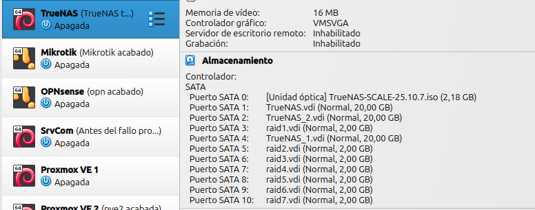
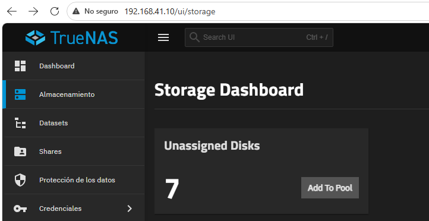
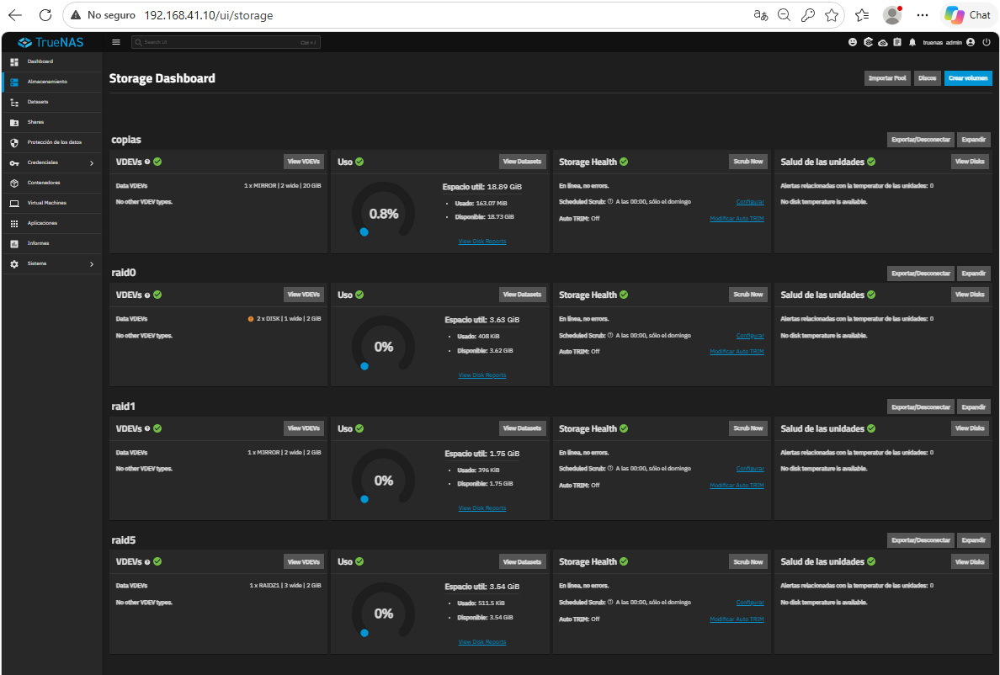
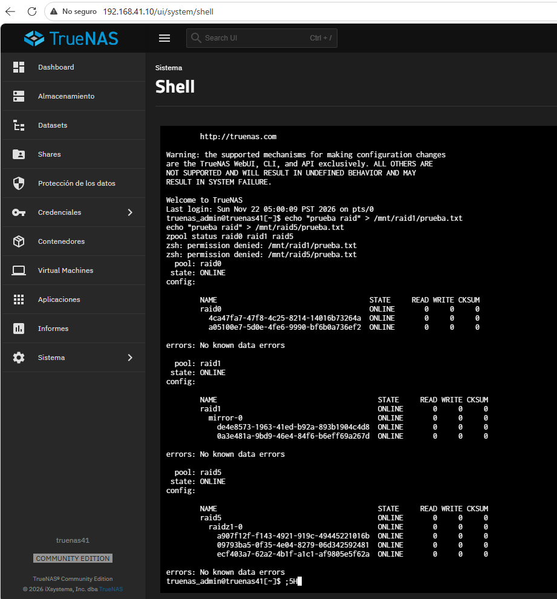

# T6 - RAID

Los RAID se hacen en TrueNAS. TrueNAS usa ZFS y cada tipo de RAID tiene su nombre:

| RAID | En ZFS | Discos | Espacio util |
|---|---|---|---|
| RAID 0 | Stripe | 2 de 2 GB | 3,63 GB |
| RAID 1 | Mirror | 2 de 2 GB | 1,75 GB |
| RAID 5 | RAIDZ1 | 3 de 2 GB | 3,54 GB |

## Discos

Se anaden 7 discos de 2 GB (raid1.vdi a raid7.vdi) a la maquina de TrueNAS en VirtualBox. Los otros discos de 20 GB son el del sistema y los dos del pool copias.

TrueNAS ve los 7 discos nuevos sin asignar. Con ellos se crea un pool para cada tipo desde Almacenamiento > Crear volumen.

## Pools creados

Los tres pools salen en el Storage Dashboard junto al pool copias:
- raid0: 2 x DISK, 3,63 GB utiles, casi la suma de los dos discos. Sale con un aviso naranja porque no tiene redundancia.
- raid1: 1 x MIRROR de 2 discos, 1,75 GB utiles, la mitad.
- raid5: 1 x RAIDZ1 de 3 discos, 3,54 GB utiles, se pierde un disco para la paridad.

## Verificacion

Con zpool status se ve que los tres pools estan ONLINE y como se reparten los discos: raid0 con los discos sueltos, raid1 dentro de un mirror y raid5 dentro de un raidz1.

## Que aporta cada RAID

RAID 0 (Stripe):
- Reparte los datos entre los discos, asi que lee y escribe mas rapido.
- Se aprovecha todo el espacio.
- No tiene ninguna proteccion. Si falla un disco se pierde todo.
- Sirve para datos temporales donde importa la velocidad.

RAID 1 (Mirror):
- Guarda lo mismo en los dos discos.
- Si falla un disco los datos siguen en el otro.
- Se pierde la mitad del espacio.
- Sirve para datos importantes, como las copias. El pool copias de este proyecto es un mirror.

RAID 5 (RAIDZ1):
- Reparte los datos y guarda paridad entre los discos.
- Aguanta que falle un disco.
- Se pierde el espacio de un disco, asi que aprovecha mas que el RAID 1.
- Necesita minimo 3 discos y escribe algo mas lento por calcular la paridad.
- Sirve para tener bastante espacio con proteccion.
