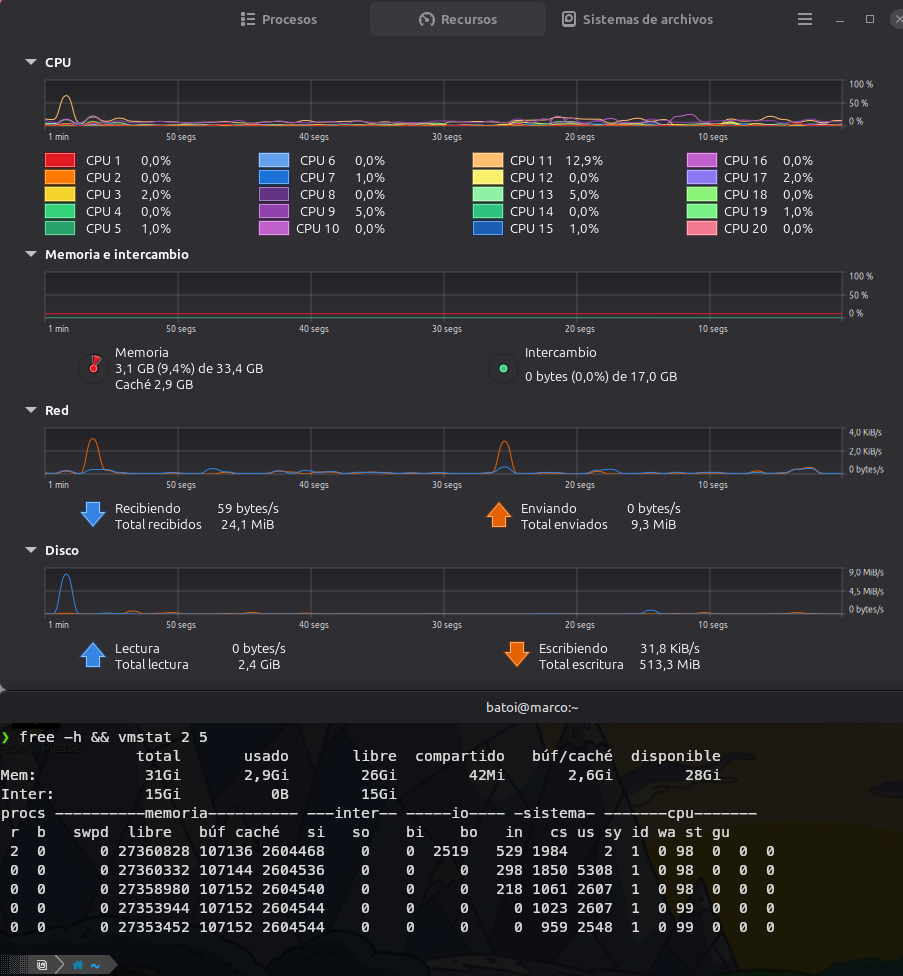
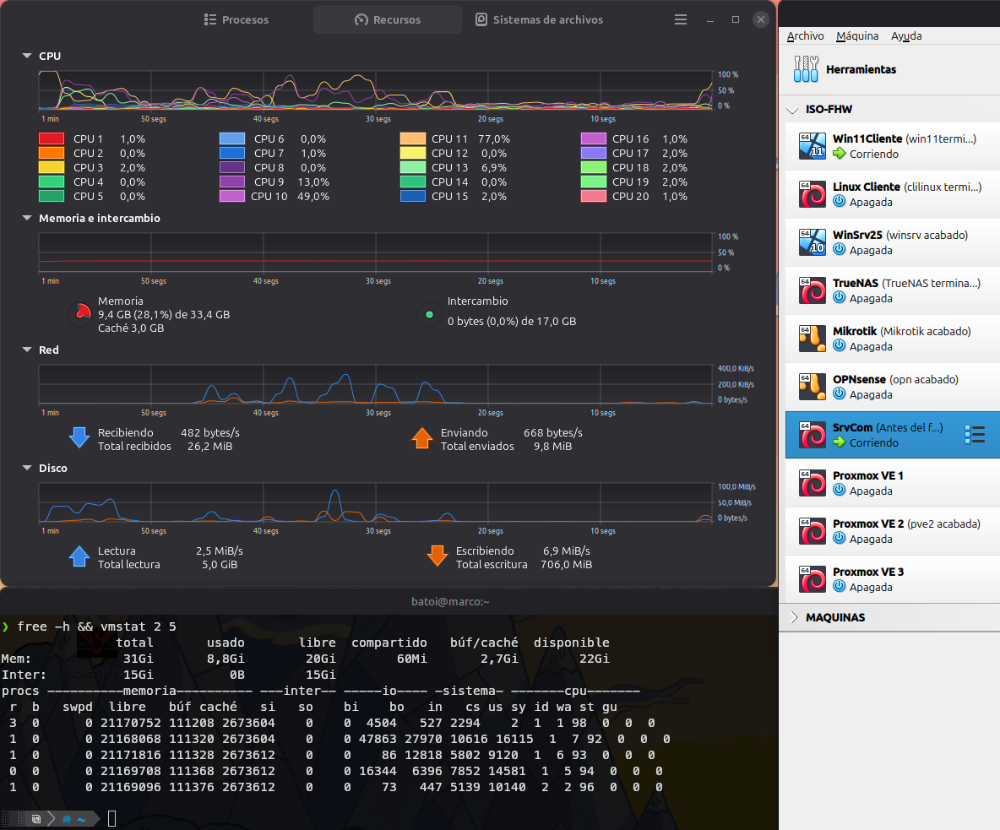
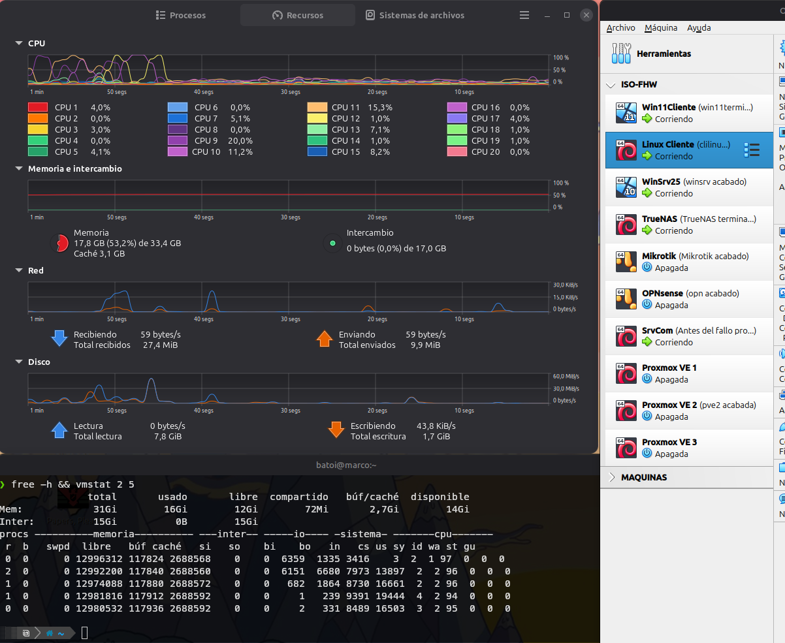
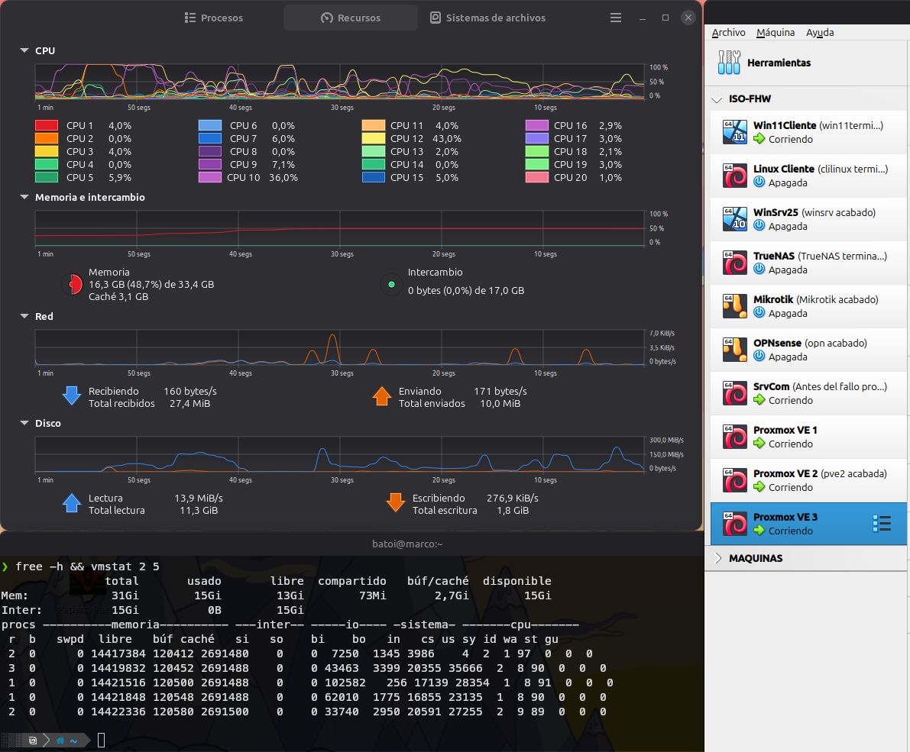

# T7 - Rendimiento

Se mide el equipo de casa (i7-12700KF, 20 hilos, 32 GB de RAM, Linux Mint) con cuatro cargas distintas.

Herramientas:
- Monitor del sistema (pestana Recursos) para ver CPU, RAM, red y disco en grafica.
- free -h para la memoria y vmstat 2 5 para CPU (us, sy, id, wa), swap (si, so) y disco (bi, bo).

En cada carga se espera un minuto despues de arrancar las maquinas.

## Carga 0: sin VMs

El equipo esta en reposo: 3,1 GB de RAM usados (9 %), la CPU al 98-99 % libre, sin swap y casi sin uso de red ni disco.

## Carga 1: SrvCom + Win11Cliente

La RAM sube a 9,4 GB (28 %). Algun nucleo llega al 77 % mientras Windows arranca y reproduce el video, pero la CPU total sigue libre al 92-98 %. La red llega a unos 400 KB/s con el video y el disco tiene picos de 100 MB/s de lectura.

## Carga 2: SrvCom + TrueNAS + WinSrv25 + Win11 + LinuxCliente

Con 5 VMs la RAM usada es 17,8 GB (53 %) y quedan 14 GB disponibles. La CPU sigue libre al 94-97 % y no se usa swap. El disco tiene picos de 60 MB/s.

## Carga 3: SrvCom + Win11 + 3 nodos Proxmox

La RAM usada es 16,3 GB (49 %). La CPU de sistema (sy) sube al 8-9 % porque Proxmox es un hipervisor dentro de otro y VirtualBox trabaja mas. El disco tiene picos de 300 MB/s de lectura (bi hasta 102582), que es lo mas alto de todas las pruebas.

## Resumen

| Carga | VMs | RAM usada | CPU libre | Disco (pico) | Swap |
|---|---|---|---|---|---|
| 0 | 0 | 3,1 GB (9 %) | 98-99 % | casi 0 | 0 |
| 1 | 2 | 9,4 GB (28 %) | 92-98 % | 100 MB/s | 0 |
| 2 | 5 | 17,8 GB (53 %) | 94-97 % | 60 MB/s | 0 |
| 3 | 5 (3 Proxmox) | 16,3 GB (49 %) | 89-91 % | 300 MB/s | 0 |

## Interpretacion

- RAM: es el recurso que mas sube, unos 3 GB por cada VM. Las VMs tienen asignados 30,5 GB en total y el equipo tiene 32 GB, asi que no caben todas. Cuando se arranco una VM dentro de Proxmox con muchas maquinas encendidas, VirtualBox se colgo.
- CPU: no se satura. Solo suben algunos nucleos al arrancar los sistemas. Con Proxmox sube la parte de sistema por la virtualizacion anidada.
- Disco: el SSD externo por USB tiene picos fuertes al arrancar, sobre todo con Proxmox. Es el segundo cuello de botella porque hace que todo arranque mas lento.
- Red: casi no se usa, no es un problema.

## Cuantas VMs se pueden tener

Dejando unos 5 GB libres para el Linux Mint y un margen de seguridad, se pueden usar unos 22-24 GB para VMs. Con lo medido, se pueden tener 5 o 6 VMs encendidas a la vez sin bloquear el equipo. Las 10 a la vez no.

Por eso se trabaja por escenarios (ver Limitaciones de la T0) y se apagan las maquinas que no hacen falta.
