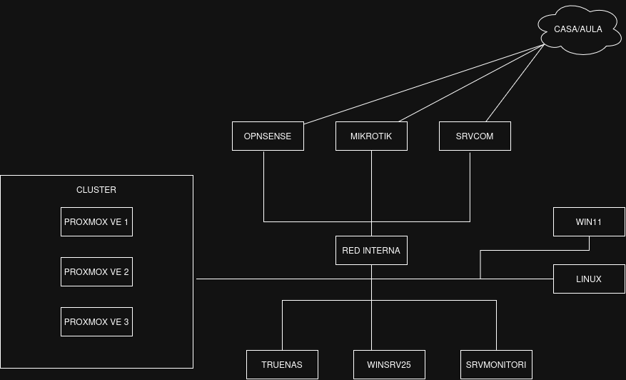

# Naix un sistema - Entorno de pruebas individual

ASIX ThinkLab - 1 ASIX - CIP FP Batoi

Entorno de pruebas individual del proyecto Naix un sistema: una copia pequena del sistema de la empresa (comunicaciones, virtualizacion, almacenamiento, dominio y clientes) montada con maquinas virtuales en VirtualBox.

En el repositorio no hay contrasenas ni credenciales.

## Tareas

| Tarea | Contenido | Apto | Apto+ |
|---|---|---|---|
| T0 | Montaje del entorno | [Limitaciones](Documentacion/T0-Montaje/Ap/Limitaciones.md) | [Esquema](Documentacion/T0-Montaje/+Ap/Esquema_mv.md), [Recursos](Documentacion/T0-Montaje/+Ap/Recursos.md) |
| T2 | Equipos y perifericos | [Inventario clase](Documentacion/T2-Equipos_Perifericos/Ap/Inventario-Clase.md), [Inventario casa](Documentacion/T2-Equipos_Perifericos/Ap/Inventario-Casa.md), [Comparativa](Documentacion/T2-Equipos_Perifericos/Ap/Comparativa.md) | - |
| T4 | Diseno fisico y logico | [Esquema de red](Documentacion/T4-Diseño_fisico_logico/Ap/Esquema_red.md), [Direcciones](Documentacion/T4-Diseño_fisico_logico/Ap/Direcciones-Previstas.md) | [Pruebas de red](Documentacion/T4-Diseño_fisico_logico/Ap+/Pruebas-red.md) |
| T5 | Instalacion y comunicaciones | [SrvCom](Documentacion/T5-Instalacion_com/Ap/SrvCom.md), [MikroTik](Documentacion/T5-Instalacion_com/Ap/MikroTik.md), [OPNsense](Documentacion/T5-Instalacion_com/Ap/OPNsense.md), [TrueNAS](Documentacion/T5-Instalacion_com/Ap/TrueNAS.md), [Proxmox](Documentacion/T5-Instalacion_com/Ap/Proxmox.md), [WinSrv25](Documentacion/T5-Instalacion_com/Ap/WinSrv25.md), [Win11Cliente](Documentacion/T5-Instalacion_com/Ap/Win11Cliente.md), [LinuxCliente](Documentacion/T5-Instalacion_com/Ap/LinuxCliente.md), [Copias](Documentacion/T5-Instalacion_com/Ap/Copias.md), [Hashes](Documentacion/T5-Instalacion_com/Ap/Hashes.md), [Problemas](Documentacion/T5-Instalacion_com/Ap/Problemas.md) | - |
| T6 | Almacenamiento y RAID | [RAID](Documentacion/T6-Almacenamiento/Ap/RAID.md) | - |
| T7 | Rendimiento | [Informe](Documentacion/T7-Rendimiento/Ap/Informe-rendimiento.md) | - |
| T8 | Prueba final (25/11) | - | - |

## Equipos

| | Clase (portatil) | Casa (sobremesa) |
|---|---|---|
| CPU | Intel Core Ultra 5 125H | Intel Core i7-12700KF |
| RAM | 32 GB | 32 GB |
| SO | Linux Mint | Linux Mint |

## Maquinas virtuales



| Funcion | Maquina | IP |
|---|---|---|
| Comunicaciones | SrvCom (Debian 13 con nftables) | 192.168.41.1 |
| Comunicaciones | MikroTik | 192.168.41.2 |
| Comunicaciones | OPNsense | 192.168.41.3 |
| Almacenamiento | TrueNAS | 192.168.41.10 |
| Virtualizacion | Proxmox VE 1, 2 y 3 | 192.168.41.21, .22 y .23 |
| Dominio | WinSrv25 (srv41.local) | 192.168.41.30 |
| Cliente | Win11Cliente | 192.168.41.100 |
| Cliente | LinuxCliente | 192.168.41.101 |

Red LAN 192.168.41.0/24 (intnet41). Los servidores de comunicaciones salen a internet por el NAT de VirtualBox.

Las VMs suman unos 30,5 GB de RAM y el equipo tiene 32 GB, asi que se encienden por grupos segun la prueba.

## Estructura

```text
Documentacion/   - una carpeta por tarea, con Ap (Apto) y +Ap / Ap+ (Apto+)
Medios/          - capturas y esquemas de cada tarea
Herramientas/    - script para sacar el inventario
```
